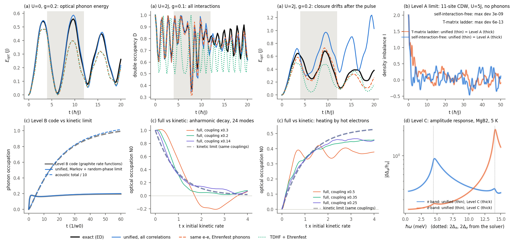
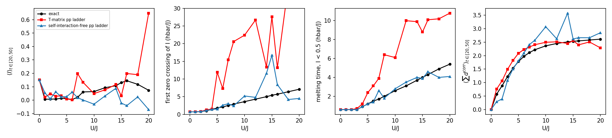
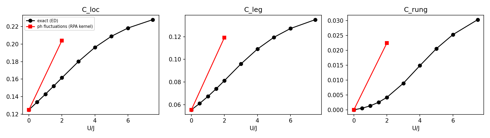
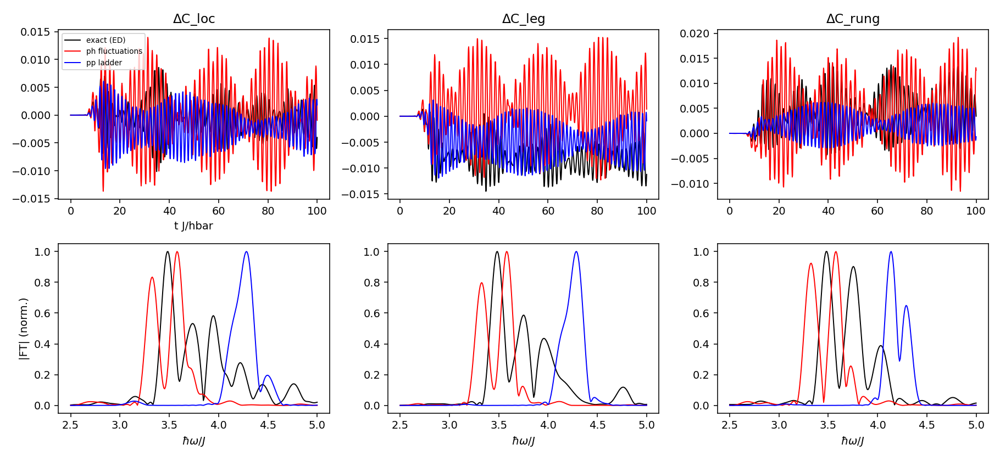
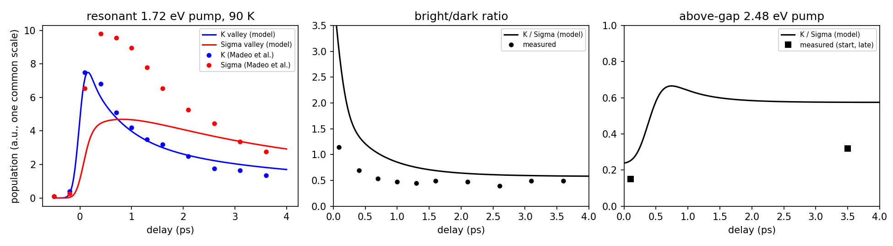
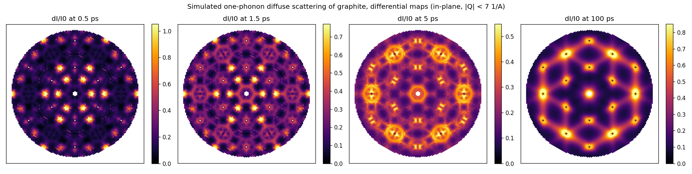
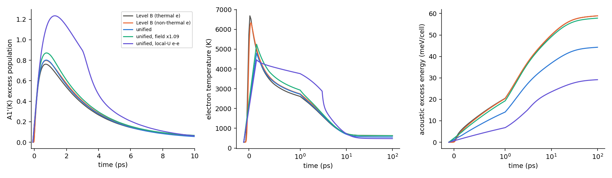
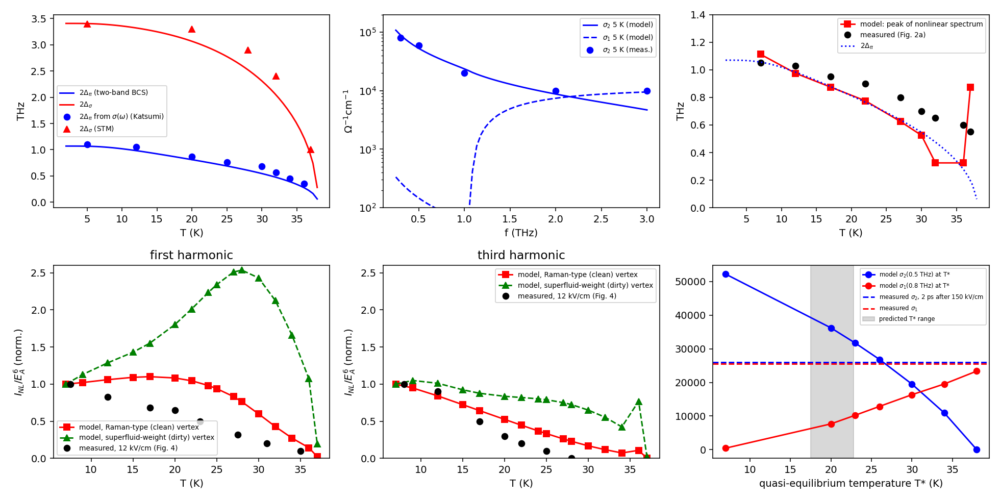
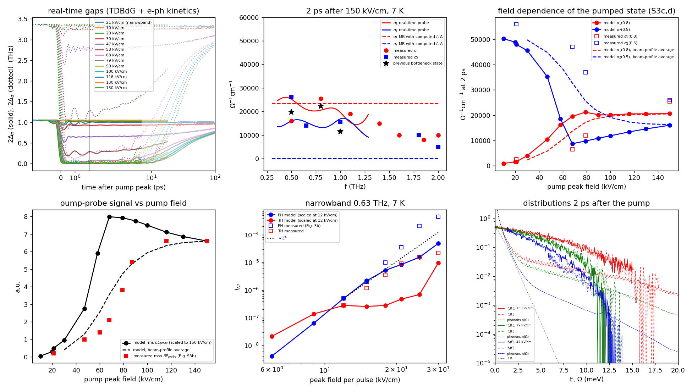
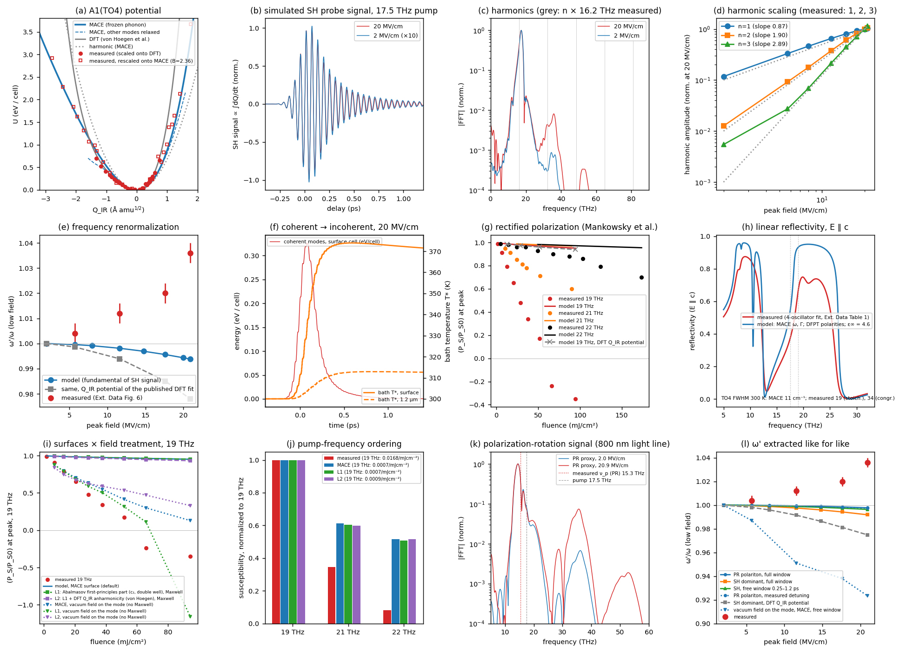

# Fast many-body dynamics of light-driven materials

**Ansh Mishra, Aryan Senthilkumar**

Technical report for Discovered Materials Grand Challenge 04, "Tuning Materials with Light".

- Every number below is produced by the code in this repository.
- `python run_all.py` regenerates all results and figures (see section 7).

---

## 1. Summary

We present one time-linear solver for driven electron–phonon matter and three production
levels that are its controlled limits.

- **One solver** (`lightmat/unified.py`, §2.0) propagates the Nambu one-body density matrix,
  positive-factorized pair correlations, phonon means, covariances and three-phonon
  correlations, and the mixed electron–phonon correlations, all in one time variable. With
  e–e, e–ph and ph–ph on at once it is checked against exact diagonalization, and graphite is
  run through it end to end, from the light field to three-phonon decay.
- **Levels A, B, C** are its limits, checked numerically: no phonons (Level A, to 6×10⁻¹³),
  Markov + random phase (Level B collision operators, to 10⁻¹⁵), pairing mean field and its
  linearization (Level C gaps to 10 digits, amplitude mode within 3 %).
- **Targets.** The four challenge targets (Hubbard models, WSe₂, graphite, MgB₂), light
  driving an infrared phonon directly (LiNbO₃, §3.5), and any material from its structure
  (`run_material.py`, §3.6), tested blind on black phosphorus with predictions committed to git
  before the measurements were compiled.

| Level | Propagated objects | Interactions | Cost / step | Used for |
|---|---|---|---|---|
| A. Positive-factorized pair fluctuations | ρ and low-rank factors x, y of the pair matrices X = A+𝒢, Y = B+𝒢 (pp channel); Hermitian fluctuation samples V (ph channel) | e–e in the T-matrix (pp), self-interaction-free pp (strong coupling, exact for two particles) and RPA/GW (ph) channels | O(r L³) | Hubbard chains and ladders |
| B. Kinetic (Markov) limit with first-principles couplings | electronic energy, phonon occupations n_qν on a full-BZ grid, exciton valley and energy populations, free carriers | e–ph (DFT/GW), full three-phonon scattering (MACE cubic force constants), exciton–ph (DFPT deformation potentials) | O(N_proc) | graphite, WSe₂ |
| C. Two-band time-dependent Bogoliubov–de Gennes with collisions | two-band Nambu one-body density matrices in the disorder-eigenstate basis; quasiparticle and phonon populations; amplitude-mode propagator (weak-field limit) | phonon-mediated pairing mean field (Liu–Mazin–Kortus λ), impurity-assisted light coupling (random velocity operator fixed by σ_n), thin-film electrodynamics, Chang–Scalapino electron–phonon collisions with first-principles α²F_ab, phonon escape | O(N³) per step, N ≈ 300 levels per band | MgB₂; weak-field harmonics also from the Level C amplitude propagator |

**Scorecard.**
- Every entry is a prediction: no parameter was adjusted to the data shown.
- The exceptions are explicitly marked "fit".
- "ED" is our own exact diagonalization, which reproduces the reference's exact results (e.g. the 3.48 J spin-correlation frequency of the laser-driven ladder).

| Target | Quantity | This work | Reference | |
|---|---|---|---|---|
| **0 One solver** (`lightmat/unified.py`) | Level A limit (no phonons), 11-site CDW U/J = 5, t ≤ 50 | max \|ΔI\| 6×10⁻¹³ (T-matrix), 3×10⁻⁹ (sic) | `fluct_hubbard.PPLadder` | ✔ |
| | Level B limit: Markov + random-phase collision integrals | 2×10⁻¹⁵ (three-phonon), 1×10⁻² (e–ph, detailed-balance form) | graphite `phph_rate`, `eph_rate` | ✔ |
| | Level B dynamics, graphite protocol | N_opt within 3.5 %, acoustic within 2.2 % | graphite rate functions | ✔ |
| | full vs kinetic as coupling decreases | deviation 0.34 → 0.11 (ph–ph), 3.4 → 0.13 (e–ph); finite-size floor 0.15–0.25 | kinetic limit | ≈ |
| | Level C limit: MgB₂ gaps | 2.2066836, 7.0387521 meV (identical) | `twoband` gap equation | ✔ |
| | Level C limit: amplitude (Higgs) response | within 2.9 %; peaks 4.58, 14.14 meV in both | `twoband` D(ω) | ✔ |
| | e–ph + ph–ph + light vs ED (U = 0, g = 0.2) | D 0.045, E_opt 0.05 of 0.56 (Ehrenfest 0.12, 0.16); O(g⁴) | ED | ✔ |
| | all three interactions vs ED (U = 2J, g = 0.1) | E_soft err 0.009 (Ehrenfest 0.033), D 0.13 | ED | ≈ |
| | all three interactions vs ED (U = 2J, g = 0.2) | closure drifts after the pulse (E_opt err 0.93) | ED | ✘ |
| | energy conservation, all three interactions | \|E − W − E₀\| ≤ 3×10⁻⁸ | — | ✔ |
| **1 Hubbard 11-site CDW** | stability, U/J = 0…20 | stable for every U | GKBA+TPP unstable for U/J ≳ 12 | ✔ |
| | long-time ⟨I⟩ over 16 values of U | mean abs. error 0.07 (T-matrix), 0.06 (self-interaction-free) | ED | ✔ |
| | long-time Σd_corr | 12 % (T-matrix), 17 % (self-interaction-free) mean error | ED | ✔ |
| | melting time t(I < 0.5), 16 values of U/J = 0…20 | self-interaction-free pp ladder: mean error 0.29 ħ/J (U/J = 5: 1.2 vs 1.2; U/J = 15: 3.9 vs 4.0); T-matrix ladder: 2.98 ħ/J | ED | ✔ |
| | first zero crossing of I | mean error 1.8 ħ/J (T-matrix ladder 10.4 ħ/J); late at U/J = 15 (16.7 vs 5.4), where the curve hovers just above zero | ED | ≈ |
| **1 Hubbard 6×2 ladder** | ground-state C_loc, C_leg, C_rung | pp ladder: C_loc, C_leg within 1.5 % at U/J = 0.5, 5 % at U/J = 1; −18 % (C_loc) at U/J = 4 | ED | ✔ for U/J ≤ 2 |
| | laser-driven ΔC spectrum | dominant line 3.58 J (ph fluctuations) | 3.48 J (ED) | ✔ (3 %) |
| **1 1D optical conductivity** | Mott gap (band edge, L = ∞), U/J = 6, 12; doublon–holon pair closure, HF + spin-wave ground state | 2.91, 8.45 J | Bethe ansatz 2.89, 8.46 J | ✔ (+0.6 %, −0.0 %) |
| | same, Hartree–Fock ground state only | 2.67, 8.33 J | 2.89, 8.46 J | ✔ (−7.8 %, −1.5 %) |
| | threshold / peak on the open 14-site chain, U/J = 6 | 3.06 / 5.31 J | ED 3.06 / 4.67 J | ✔ / ≈ |
| | threshold / peak on the open 14-site chain, U/J = 12 | 8.63 / 11.38 J | ED 8.63 / 11.44 J | ✔ |
| | line-shape distance to ED (0 = identical, 2 = disjoint), envelope η = 0.5 J, U/J = 6, 12 | 0.12, 0.15 (TDHF/RPA: 0.71, 0.77) | ED, open 14 sites | ✔ |
| | U/J = 3 (outside the strong-coupling closure) | band edge 0.81 J; 14-site threshold / peak 0.95 / 2.61 J | Bethe 0.63 J; ED 0.92 / 1.22 J | ✘ (peak); TDHF/RPA 1.56 J onset at 64 sites |
| **2 WSe₂** | E(Σ-K) − E(K-K) | +6.8 meV | degenerate within 15 meV (≈ +3 meV) | ✔ |
| | Σ maximum among the measured delays (the "~400 fs", Fig. 3d,e) | 0.40 ps | 0.40 ps | ✔ |
| | delay between the sampled K and Σ maxima (the "~300 fs", SI §9, Fig. S11) | 0.31 ps | 0.31 ps | ✔ |
| | effective K→Σ time, two-level fit at the measured delays (same fit for model and data) | 81 fs | 115 fs (104–130; 88–158 with ±50 fs time zero) | ≈ (×0.7) |
| | K/Σ at −0.2, 0.09, 0.4 ps | 1.56, 1.03, 0.70 | 1.6, 1.15, 0.69 | ✔ |
| | K and Σ densities at all measured delays (0.09–3.6 ps), one common scale | rms deviation 6.7 % of the Σ peak | Fig. 3c | ✔ |
| | peak Σ / peak K | 1.18 | 1.3 | ✔ |
| | late K/Σ ratio (resonant) | 0.57 | 0.47 | ✔ (≈) |
| | late decay of Σ, 1–3.6 ps | 3.7 ps (two-level fit 2.9 ps) | 2.2–2.5 ps (two-level fit 2.4 ps) | ≈ |
| | bright-exciton phonon linewidth at 50 K (independent check of the couplings) | 6.9 meV FWHM | 6.0 meV (Moody et al. 2015) | ✔ |
| | above-gap K/Σ | 0.28 → 0.57 (rising) | 0.15 → 0.32 (rising) | qualitative |
| **3 Graphite** | A1′(K) peak time | 0.70 ps | 0.6–0.7 ps | ✔ |
| | K-point diffuse rise (fit as in experiment) | 0.29 ps | 0.28 ps | ✔ |
| | K-point diffuse decay (fit as in experiment); A1′ population 1/e | 2.46 ps; 3.2 ps | 1.7 ps | ✘ (×1.45) |
| | energy flow optical → acoustic → flexural, mode- and q-resolved | yes | yes | ✔ |
| | one-phonon diffuse-scattering maps at 0.5, 1.5, 5, 100 ps | K-point spots early, Bragg-adjacent rings late (fig. `graphite_diffuse_maps.png`) | same sequence (Fig. 2 of the reference) | ✔ qualitative |
| | diffuse rise at mid-zone K/2, M/2 | 0.82, 1.31 ps | 1.0–1.5 ps | ✔ |
| | diffuse rise at M: M point / 0.3 Å⁻¹ region | 8.7 / 3.8 ps | 2.1 ps (Stern 2018) | ✘ / ≈ |
| | TA pooling at ⅓M and M (challenge reference, René de Cotret 2019) | 90 % of final excess at 47 ps / 25 ps | "> 25 ps" | ✔ |
| | AB-stacked graphite (12 branches) vs matched graphene control | decay 2.37 vs 2.55 ps (−7 %) | — | interlayer modes are not the missing channel |
| | all three interactions explicit (non-thermal carriers, e–e, e–ph, ph–ph) | A1′ peak 0.73 ps, decay 3.17 ps; thermal-electron model 0.70 / 3.20 ps | — | ✔ validates the thermal limit |
| | energy conservation | exact | — | ✔ |
| | **one solver, light to phonons** (`materials/graphite_unified`): absorbed energy from the coherent Bloch calculation | 65.9 meV/cell (absorptance 0.35; strongly nonlinear, ∝ I^1.6) | linear optics 91 meV/cell (0.48) | prediction (differs) |
| | A1′(K) peak / 1/e decay at equal absorbed energy | 0.75 / 3.05 ps | Level B 0.70 / 3.20 ps; measured 0.6–0.7 / 1.7 ps | ✔ vs Level B; ✘ decay vs experiment (as Level B) |
| | K diffuse rise / decay (fit), equal absorbed energy | 0.35 / 2.35 ps | Level B 0.29 / 2.46 ps; measured 0.28 / 1.7 ps | ✔ vs Level B |
| | branch energies at 1.5, 5, 100 ps, equal absorbed energy | within 10 % of Level B | Level B | ✔ |
| | e–e from the solver's local-U Markov limit | 5 ps at 0.775 eV; no thermalization | measured ≈ 15 fs | ✘ (local U inadequate) |
| | energy conservation, light → phonons, 100 ps | 3 % | — | ≈ |
| **4 MgB₂** | 2Δ_π(0), 2Δ_σ(0) | 1.07, 3.40 THz | 1.10, 3.4 THz | ✔ |
| | 2Δ_π(T) | on the measured points from 5 to 36 K | Fig. 3c | ✔ |
| | σ₂(ω) at 5 K | 9.0, 5.3, 2.4, 0.9 ×10⁴ Ω⁻¹cm⁻¹ at 0.3, 0.5, 1, 2 THz | ≈ 8, 6, 2, 1 ×10⁴ | ✔ |
| | broadband nonlinear peak vs T | 1.11, 0.98, 0.88, 0.78, 0.62 THz at 7, 12, 17, 22, 27 K | 1.05, 1.03, 0.95, 0.90, 0.80 | ✔ (≤ 22 K) |
| | normalized TH vs T (π-band paramagnetic vertex, δ = 0.55 THz from the experiment) | 1, 0.71, 0.41, 0.28, 0.21, 0.13 at 8, 12, 17, 20, 22, 25 K | 1, 0.9, 0.5, 0.3, 0.2, 0.1 | ✔ (≤ 0.19) |
| | normalized FH vs T (same vertex) | 1, 0.88, 0.69, 0.56, 0.44, 0.25, 0.12, 0.03 at 7.5–35 K | 1, 0.83, 0.68, 0.65, 0.50, 0.32, 0.20, 0.10 | ✔ (≤ 0.09) |
| | superfluid-weight (diamagnetic) vertex instead | FH rises to 2.5× toward T_c | monotonic fall | ✘, excluded by the data |
| | un-normalized FH maximum | 25 K | 35–36 K | ✘ |
| | conductivity 2 ps after 150 kV/cm: real-time dynamics + weak probe (no assumed state) | homog.: σ₁(0.8) = 2.06, σ₂(0.5) = 1.60, σ₂(1.0) = 1.69; beam: 2.05, 1.63, 1.59 ×10⁴ | 2.55, 2.6, 1.5 ×10⁴ | ≈ (−20 %, −37 %, +6 %) |
| | same, previous Owen–Scalapino state fixed by the linear superconducting-state absorption | 2.23, 1.98, 1.15 ×10⁴ | 2.55, 2.6, 1.5 ×10⁴ | superseded: assumes 0.61 J/mol; the dynamics absorbs 8.0 J/mol on axis, 5.0 J/mol probe-weighted |
| | narrowband 21 kV/cm pump: state at 2 ps | σ₂(0.5) −5 %, 2Δ_π −6 % | σ₂(0.5) −7 %, "almost intact" | ✔ |
| | pump-probe signal vs pump field (Fig. S3b), normalized at 150 kV/cm | beam: 0.20, 0.39, 0.54, 0.72, 0.80, 0.96, 1 at 47, 60, 68, 79, 87, 116, 150 kV/cm (homog.: saturated from 68) | 0.15, 0.21, 0.32, 0.58, 0.82, 1.00, 1 | ✔ (beam; ≤ 0.22) |
| | σ at 2 ps, 68 and 79 kV/cm | beam: σ₁(0.8) = 1.37, 1.71; σ₂(0.5) = 3.27, 2.57 ×10⁴ (homog.: 1.95, 2.12; 0.87, 0.98) | 0.65, 1.2; 4.7, 3.7 ×10⁴ | ✘ (beam: field scale ≈ 1.3–1.5× low) |
| | FH intensity vs field per pulse, normalized at 12 kV/cm | beam: 4.4, 13.0, 27.8, 58, 133 at 15, 18, 21, 25, 30 kV/cm | 4.0, 20, 70, 420, 900 (E⁶: 3.8, 11.4, 28.7, 82, 244) | ✔ E⁶ to 21 kV/cm; ✘ super-E⁶ above |
| | TH intensity vs field per pulse | beam: 1.6, 1.8, 1.8, 2.2, 4.5 | 4.3, 12.5, 32, 57, 79 | ✘ (saturates near 12 kV/cm) |
| | static depairing current density, 7 K | 7.0×10⁷ A cm⁻² (Eilenberger with Born impurities, same inputs: 6.1×10⁷) | MgB₂ films 2×10⁷ (pulsed transport) to ~10⁸ | ✔ |
| | π gap during a 30 kV/cm narrowband pulse | 0.85 (one pulse), 0.39 (A+B superposed), pulse-weighted | 0.81 (scale factor of the authors' fit) | ≈ / ✘ |
| **5 LiNbO₃, light driving an IR phonon** (nonlinear phononics) | A1 TO frequencies | 243, 278, 357, 608 cm⁻¹ | 252, 275, 332, 632 cm⁻¹ | ✔ |
| | TO4 three-phonon linewidth, 300 K / 10 K | 10.8 / 5.0 cm⁻¹ | 18.9 / 9.3 cm⁻¹ (stoichiometric Raman) | ✘ (×0.55) |
| | harmonic field scaling n = 1, 2, 3 | exponents 0.87, 1.90, 2.89 | 1, 2, 3 | ✔ |
| | excursion / coherent energy at 20 MV/cm | −0.76 Å amu^1/2 / 0.33 eV | 1.4 Å amu^1/2 (DFT-scaled) / 0.6–0.7 eV | ≈ (×0.5) |
| | potential asymmetry (excursion ratio at 0.7 eV) | 1.29 | 1.77 | ✘ (MACE a₃ 3× below DFT) |
| | frequency shift at 20.9 MV/cm, like-for-like readout (polarization rotation / SH, both windows) | −0.07 % to −0.8 % (DFT Q_IR: −2.5 %) | +3.6 % | ✘ (sign, independent of potential and readout) |
| | polariton fundamental in the polarization-rotation signal | 14.49 THz | 15.3 THz | ✔ (−5 %) |
| | P_S/P_S0 at 94.5 mJ/cm² (19 THz), Maxwell field | 0.95 (MACE); 0.95 / 0.93 (literature L1 / L2) | −0.35 | ✘ (not a MACE error) |
| | same, vacuum field applied to the modes (literature-style single cell) | 0.13 (MACE), −1.16 (L1) | −0.35; 0.79 at 12.8 mJ/cm² (MACE: 0.79) | diagnostic |
| | frequency ordering of P_S susceptibility (19 > 21 > 22 THz) | 1 : 0.60 : 0.51 (all surfaces) | 1 : 0.35 : 0.08 | ≈ |
| | coherent ↔ incoherent energy conservation | 2×10⁻⁴ | — | ✔ |
| **6 Blind test: black phosphorus** (`run_material.py`, predictions committed before the data were compiled) | absorbed energy density | 377 J/cm³ | 380 ± 70 J/cm³ (Zahn 2020) | ✔ |
| | ΔMSD zigzag τ₁ / τ₂ | 0.81 / 20.5 ps | 0.58 / 20 ps | ≈ / ✔ |
| | ΔMSD armchair τ₁ / τ₂ | 0.12 / 14.0 ps | 0.48 / 22 ps | ✘ / ≈ |
| | diffuse at Seiler's A / X (points matched by coordinates) | rise 1.9 ps, relax 19 ps / 11.0 ps | 1.7, 30 ps / 14.3 ps | ✔, ≈ / ✔ |
| | late ΔMSD amplitude, anisotropy armchair/zigzag | 2.5–3× too large; 1.91 | 1.53 / 2.50 ×10⁻³ Ų; 1.63 | ✘; ≈ |
| **Speed (measured)** | two-time KBE (second Born, our implementation) vs this work, 11-site chain, same dt and machine | cost ∝ N_t^1.21 vs N_t^3.15; 300× faster at N_t = 400; extrapolated 10⁴× (9 s vs 29 h, KBE needing 48 GB) at t = 50 ħ/J | — | ✔ |
| **Speed** | graphite: 576 q × 6 branches, 1.2×10⁷ three-phonon processes, 100 ps | 11 min, 1 CPU core | two-time NEGF: not feasible | ✔ |

---

## 2. Method

### 2.0 One hierarchy, one solver

Levels A, B and C are not three codes but three limits of one set of equations, implemented in
`lightmat/unified.py` (class `UnifiedSolver`).

**Hamiltonian.** The solver takes the general Hamiltonian
H = Σ h_ij(t) c†_iσ c_jσ (light by Peierls or dipole) + U Σ n_i↑ n_i↓ + Σ V_ij c†_i↑ c†_i↓ c_j↓ c_j↑ (e–e)
+ Σ ω_a (x_a² + p_a²)/2 + Σ f_a(t) x_a (phonons, IR drive)
+ Σ x_a γ^a_ij c†_iσ c_jσ (linear e–ph)
+ (1/6) Σ κ_abc x_a x_b x_c (cubic ph–ph).

**Propagated objects.** All of them obey ODEs in one time variable:
- the Nambu one-body density matrix Γ, holding ρ↑, ρ↓ and the anomalous κ;
- the e–e pair correlation G2, in the positive-factorized form of Level A (pair factors x, y), plus a dense phonon-exchange part;
- the coherent displacements ⟨x⟩, ⟨p⟩;
- the phonon one-body matrices S (equivalent to ⟨b†b⟩ and ⟨bb⟩);
- the three-phonon correlation T;
- the electron–phonon correlations C^μ = ⟨Ψ†Ψ δξ_μ⟩_c.

**Equations of motion.** They follow from the Heisenberg (equivalently Wigner–Moyal) equations. Every connected correlation with more than three field operators is dropped, except G2.
1. **One body (exact).** i∂_tΓ = [H_HFB, Γ] + Σ_a [G^a, C^{x_a}] + I_ee[G2]. The phonon mean values are given exactly by Ehrenfest with ⟨xx⟩ = XX + S, and S by the exact contraction with C and T.
2. **Electron–phonon correlation.** C evolves with the mean-field (HFB + RPA) electron dynamics and the phonon matrix. Its source is
   −½[(1−Γ)G^aΓ + ΓG^a(1−Γ)] − i Σ_b S_{x_b μ}[G^b, Γ] − γ^a·G2.
   This is the Fan–Migdal source of Karlsson et al. (PRL 127, 036402), dressed by e–e correlation. With S = N + ½ it contains the factors (1−f) f (1+N) − f (1−f) N.
3. **Three-phonon correlation.** T has the Gaussian source −κ S S plus the quantum term κ/4. The κ/4 term produces spontaneous decay; a classical treatment of the phonons misses it (the zero-point leakage of our earlier trajectory attempt).
4. **Phonon-exchange part of G2.** Its source is Σ_e ([γ^e, ρ↑] ⊗ C↓^e + C↑^e ⊗ [γ^e, ρ↓]).

**Conservation.** The truncated equations conserve ⟨H⟩ minus the work of the fields to 10⁻⁸–10⁻¹¹ without any correction step.

**The limits.**

| Level | Approximation of the one solver | Check (`benchmarks/unified_limits`) |
|---|---|---|
| A | γ = κ = 0 (no phonons): eqs. 2–4 vanish; eq. 1 + G2 are the Level A pair ladder | identical to `fluct_hubbard.PPLadder`: 11-site CDW, U/J = 5, t = 0–50 ħ/J, max \|ΔI\| = 6×10⁻¹³ (T-matrix), 3×10⁻⁹ (self-interaction-free) |
| B | Markov + random-phase: C and T solved adiabatically with a dephasing memory kernel; only populations kept | collision integrals identical to the golden rule (2.7×10⁻¹⁵) and to graphite's three-phonon operator (`phph_rate`, 2×10⁻¹⁵) |
| C | phonon-mediated pairing V < 0 (Eliashberg-derived), no G2: stationary point of eq. 1 + its linearization | two-band gaps identical to `materials/mgb2/twoband` (10 digits); amplitude response = D(ω)V⁻¹ − 1 within 2–3 %, Higgs peaks coincide |

**(a) All three interactions against exact diagonalization.**

*Setup.* Hubbard–Holstein dimer with one ↑ and one ↓ electron, starting as a doublon:
- each site has an optical mode (ω = 1) with Holstein coupling g, and a soft mode (ω = 0.5);
- the cubic term λ x_a x_b² (λ = 0.1) makes the optical mode decay resonantly into soft pairs;
- a Peierls light pulse drives the bond;
- the run lasts t = 0–20 ħ/J;
- ED phonon cutoffs are 10, 10, 13, 13 (changing them moves the results by < 10⁻³).

*Comparisons.* The full solver is compared with two references:
- the same e–e treatment with Ehrenfest phonons ("Ehr.");
- TDHF + Ehrenfest.

*U = 0.* Electron–phonon and phonon–phonon correlations plus light, but no e–e interaction.
- The scheme is exact to O(g²): errors are O(g⁴), against O(g²) for Ehrenfest.
- At g = 0.1, t ≤ 8: D error 4×10⁻⁴ (Ehr. 9×10⁻³); optical phonon number 9×10⁻⁴ (Ehr. 2×10⁻²).
- At g = 0.2, t ≤ 20: D error 0.045 (Ehr. 0.119); E_opt error 0.051 of 0.56 (Ehr. 0.16); E_soft error 0.025 of 0.13 (Ehr. 0.028).

*U = 2.* All three interactions are active at once.
- The e–e part is exact for two electrons.
- At g = 0.1 the full solver improves both phonon channels: E_opt error 0.068 (Ehr. 0.088); E_soft error 0.009 (Ehr. 0.033, TDHF 0.10).
- D is within 0.13 over t = 0–20 (Ehr. 0.10; TDHF 0.60).
- At g = 0.2 the second-order closure drifts after the pulse (E_opt error 0.93 of 0.68), while Ehrenfest stays within 0.15. Up to the pulse (t ≤ 8) the full solver's D error is 0.10, against Ehrenfest's 0.11.

*Origin of the U = 2 limit.* The phonons are driven by the doublon's correlated charge fluctuations. C propagates these only with TDHF/RPA electron dynamics, because the e–e–ph correlation ⟨c†c†cc δx⟩_c is dropped. In the same way, the unpositivized closures become unstable once relaxation rates approach the phonon frequency.

**(c) Kinetic limit, dynamics.**

*Level B protocol.* We use graphite's protocol: thermal hot electrons, an optical mode, and 16 acoustic modes. Two runs over t = 0–60 are compared:
- graphite's own rate functions, fed with the model couplings;
- the solver's kinetic limit.

Results: optical occupation within 3.5 %, acoustic total within 2.2 %, T_e within 1.1 %. The residual comes from graphite's detailed-balance form of the electron–phonon term with a broadened δ (0.07–1.3 % in the rates).

*Full coherent solver against its own kinetic limit.*
- **Anharmonic decay of an optical phonon into 24 acoustic modes.** The maximum deviation of N₀ falls from 0.34 to 0.18 to 0.11 as the coupling is reduced ×0.3, 0.2, 0.14 (rates 0.25, 0.11, 0.054 ω₀). At ×0.1 it is 0.20, because the finite bath recurs.
- **Phonon heating by hot electrons (40 levels).** The deviation falls from 3.4 to 1.8, 0.29 and 0.13 at ×1, 0.7, 0.5, 0.35. It then saturates at 0.15–0.25, once the rate drops below the level spacing.
- **Stability.** At the strongest couplings (rate ≳ 0.4 ω₀) the full closure loses positivity (N < 0). The kinetic limit does not.

**(d) Superconducting limit (MgB₂ couplings, T = 5 K).**
- *Model.* Two bands of 2 × 100 and 2 × 73 levels (density-of-states ratio 0.73), with pairing −V_ab ω_c/n.
- *Gaps.* The solver's equilibrium gaps are 2.2066836193 and 7.0387521201 meV, identical to the Level C gap equation on the same levels. The continuum Level C values (`twoband.gaps`) are 2.206675 and 7.038724 meV. This gives 2Δ_π = 1.0671 THz and 2Δ_σ = 3.4039 THz.
- *Amplitude mode.* A weak pair-field pulse on the time-dependent BdG dynamics gives a response equal to the Level C propagator, D(ω)V⁻¹ − 1, within 2.2 % (π pulse) and 2.9 % (σ pulse) of its maximum over 0.5–15 meV.
- *Peaks.* Both codes put the response peaks at 4.58 and 14.14 meV (2Δ_π = 4.41, 2Δ_σ = 14.08 meV; both are shifted by the same η = 0.15 meV broadening).
- *Error source.* The residual comes from the RK4 step (dt = 0.04 ħ/meV) at the sharp σ peak.

**What this does and does not show.**

*Shown.* One code with one set of equations reproduces all three production levels in their limits:
- Level A to rounding;
- Level B's collision operators to 10⁻¹⁵;
- Level C's gap and amplitude-mode propagator to the discretization and time-step error.

The solver also runs e–e, e–ph and ph–ph coherently and simultaneously, conserving energy, and it is exact to second order in the e–ph coupling.

*Not shown.*
- Strongly correlated electrons coupled to phonons at intermediate coupling are not yet quantitative (U = 2, g = 0.2). Doing this needs a positive (sample-based) form of the mixed correlations, as Level A provides for G2.
- No material has been run through the full coherent equations. The production materials calculations remain at Levels B and C.

Figure: `figures/unified_limits.png`. Tests: `tests/test_unified.py`, 7 tests, 51 s.



### 2.1 Level A: positive-factorized pair fluctuations

Notation: ħ = 1, ρ^σ_ij = ⟨c†_jσ c_iσ⟩, ρ̄ = 1 − ρ, local interaction U Σ_i n_i↑ n_i↓.

**One-body equation (exact):**

  i ∂_t ρ^↑_ij = [h^HF_↑, ρ^↑]_ij + U (𝒢_{ii,ji} − 𝒢_{ij,jj}),

where 𝒢 is the connected part of ⟨c†_c↑ c†_d↓ c_b↓ c_a↑⟩.

**T-matrix (pp-ladder) equation.** The G1–G2 equation for 𝒢 is

  i ∂_t 𝒢 = [h₂, 𝒢] + U (A−B) P 𝒢 − U 𝒢 P (A−B) + U (A P B − B P A),

with
- A = ρ̄^↑ ⊗ ρ̄^↓ and B = ρ^↑ ⊗ ρ^↓;
- P the projector on on-site pairs;
- h₂ = h^HF_↑ ⊗ 1 + 1 ⊗ h^HF_↓.

**Key identity.** For X = A + 𝒢 and Y = B + 𝒢, this equation is equivalent to the *linear* pair

  i ∂_t X = H X − X H†,  i ∂_t Y = H Y − Y H†,  H = h₂ + U (A − B) P.

The source U(APB − BPA) is generated automatically.

**Positivity by construction.**
- Write X = x x† and Y = y y†, and propagate the rectangular factors with i ∂_t x = H x.
- Then X ≥ 0 and Y ≥ 0 at all times.
- These are the N-representability conditions whose loss makes plain G1–G2 unstable.

**Exact low rank.** For an uncorrelated initial state the factorization is exact:
- rank X = number of hole pairs, rank Y = number of particle pairs;
- there is no sampling noise;
- no N_b⁴ object is ever formed.

The correlation used in the collision integral is the Keldysh average 𝒢 = (X − A + Y − B)/2.

This is a deterministic, exact-rank, positivity-preserving formulation of the
quantum-fluctuation idea of Schroedter, Bonitz and Joost (arXiv:2606.10773). Code:
`lightmat/fluct_hubbard.py`. The plain G1–G2 mode, and a variant with positivity projection,
are in the same file for comparison.

**Self-interaction-free pair ladder for strong coupling** (`mode="sic"`).
- In the T-matrix equation each electron of a pair feels the Hartree field of the full
  density, including that of its own partner. The closure is therefore not exact even for two
  electrons: for a single doublon at U/J = 15 it gives negative densities.
- In the self-interaction-free ladder, each pair amplitude ψ_r (a column of y) evolves in the
  field of all electrons except its own two. Its own one-body matrices o_r are subtracted from
  ρ in both the Hartree term and the Pauli-blocking term U(1 − r↑⊗1 − 1⊗r↓)P, with r = ρ − o_r.
- This makes the pair dynamics exact for one up and one down electron, so the doublon
  hopping 2J²/U, which drives strong-coupling dynamics, comes out right.
- After each step a positive rescaling of the amplitudes, which keeps Y positive
  semidefinite, restores the exact pair sum rules Σ_b Y_(ab),(ab) = N↓ n↑_a (and up ↔ down)
  and exact energy conservation.
- The cost is unchanged. Results in Sec. 3.1.

**Particle–hole channel** (`lightmat/fluct_ph.py`):
- Hermitian samples V of the one-body operator fluctuations evolve with the linearized
  time-dependent Hartree–Fock kernel (RPA, GW or GW+X variants).
- Initial samples are an exact deterministic decomposition of ½⟨{δE_ab, δE_cd}⟩, or a
  Gaussian sample for large systems.
- The implementation is fully sparse: O(S M²) per step.

**Verification:**
- Without the collision term, the factorized and plain G1–G2 dynamics agree to 8 digits.
- At U/J = 1–2 both reproduce exact I(t) and d(t) (7 sites) within a few percent.
- The sparse ph kernel agrees with the dense one to 10⁻¹⁵.

### 2.2 Level B: kinetic limit with first-principles couplings

In dense photoexcited systems the dephasing is fast and the Markov limit of the level-A
equations applies. The pair-correlation equation then integrates to golden-rule collision
kernels.

**Graphite: electron–phonon.**
- π bands from nearest-neighbour tight binding (ħv_F = 6.4 eV Å).
- Coupling by bond-length modulation, β·d̂·(u_B − u_A), evaluated with the MACE phonon
  eigenvectors of all six branches on a 24×24 q-grid.
- β is fixed by the DFT value ⟨g²_K⟩ = 0.0994 eV² (Piscanec et al. 2004). The model then
  gives ⟨g²_Γ⟩ = 0.0444 eV² (DFT: 0.0405).
- The many-body (GW) enhancement of Lazzeri et al. (2008) is applied: ×193/92 for intervalley
  processes, ×1.24 for intravalley processes.
- The emission kernel is A_qν(T_e). It is averaged over each Brillouin-zone cell near Γ, K and
  K′ (4×4 sub-points; 450×450 electron grid), because the emission region there is smaller
  than one cell.
- Check at 300 K: the coupling-limited optical-phonon lifetimes are 0.6 ps (E2g, i.e.
  8.5 cm⁻¹ against 11 cm⁻¹ DFT) and 0.3 ps (A1′).

**Graphite: phonon–phonon.**
- Full nonlinear three-phonon collision integral: 1.2×10⁷ energy-allowed decay and
  coalescence processes, with detailed balance.
- Cubic force constants from MACE (`medium-omat-0`). Among six MACE foundation models this one
  reproduces the graphene phonon frequencies (E2g 193 meV against 196 measured; ZO 104 meV
  against ≈ 110).
- The absolute prefactor is calibrated against phono3py's imaginary self-energy. The spread
  over all modes is 2×10⁻⁴, so the operator is correct.
- The finite-width energy delta leaves a small residual, which is removed by a
  heat-capacity-weighted projection. Energy is then conserved exactly.
- Resulting lifetimes: A1′(K) 2.3, 1.5, 1.1 ps at 300, 600, 900 K; E2g(Γ) 2.1, 1.6, 1.2 ps.
  These are about 2× shorter than the DFT values of Bonini et al. (2007); MACE slightly
  overestimates the anharmonicity.

**WSe₂.**
- Exciton binding energies from the Rytova–Keldysh interaction (r₀ = 45.1 Å, hBN substrate)
  with DFT k·p masses.
- Exciton–phonon scattering uses the DFPT deformation potentials of Jin et al. (PRB 90, 045422,
  2014), each process with its own phonon energy:
  - K→Q: acoustic 8.2×10⁸ eV/cm; K→Q′: 5.7×10⁸; K→K′: 1.3×10⁸;
  - Q→Q′, optical intravalley, and acoustic intravalley (|D_e − D_h|) as tabulated there.
- Valley classes: K-K and K-K′ (4 species), Σ-K (12 species).
- Detailed balance at 90 K; exciton–exciton annihilation γ = 0.08 cm²/s (literature range for
  hBN-supported WSe₂).
- Above-gap excitation adds a free-carrier stage:
  - carriers are distributed over the K and Σ valleys at the carrier temperature;
  - they cool by optical-phonon emission, using the same deformation potentials;
  - they bind into excitons with a formation time of 0.5 ps (literature value).

### 2.3 Level C: superconductors (MgB₂)

**Gaps.** Two-band BCS gap equations with the Liu–Mazin–Kortus couplings (λ_ππ = 0.28,
λ_σσ = 0.96, λ_πσ = 0.19, N_σ/N_π = 0.73). The cutoff is fixed by T_c = 38 K, giving 7.3 meV
(1.8 THz), which is the value printed in the reference.

**Amplitude (Higgs) mode.** The coupled two-band amplitude-mode propagator is

  D(ω) = [V⁻¹ − diag(N_a P_a(ω))]⁻¹,  P_a(ω) = ∫dξ tanh(E/2T)/E · 4ξ²/(4E² − ω²).

**Nonlinear response.**
- Light couples to the gap amplitudes through a two-photon vertex v_a. We compare the
  superfluid-weight (diamagnetic) vertex ∂ρ_s,a/∂Δ_a with the impurity-assisted paramagnetic
  vertex v ∝ (Δ_π, 0) of the dirty π band. The nonlinear data select the second (Sec. 3.4).
- The third-order current is j₃ ∝ Σ v_a D_ab v_b A³.
- Thin-film radiation and the experiment's normalization by the transmitted field are included.

**Linear conductivity.**
- Two-band Mattis–Bardeen, with the superfluid weight corrected for finite purity
  (Abrikosov–Gor'kov sum).
- The tabulated plasma frequencies give a normal-state conductivity about 10× above the
  film's. The total σ_n is therefore set to the measured 38 K value; band ratios and
  scattering rates are kept.

**Real-time dynamics (G1 level).**
- Each band is represented in the exact-eigenstate (Anderson) basis of the disordered normal
  metal: N levels ε_n on [−W, W], each paired with its time-reversed partner. We propagate the
  two-band Nambu one-body density matrices R_a (2N × 2N) with
  iħ dR_a/dt = [H_a(t), R_a], where H_a = ε τ₃ − Δ_a τ₁ − α_a(t) τ₀ ⊗ Y_a.
  The gaps are the pairing mean field Δ_a = Σ_b V_ab N_b δ_b Σ_{|ε_n|<ω_c} R_b,he[n,n]*, with
  the Liu–Mazin–Kortus couplings and the cutoff used for the equilibrium gaps.
- **Light.** The velocity operator between disorder eigenstates is a random Hermitian matrix
  Y = iK, with K real antisymmetric (time-reversal-symmetric disorder) and
  |Y_nm|² = L_a(ε_n − ε_m)/N, where L_a is the Drude Lorentzian of width 1/τ_a. Its strength
  α_a = c_a A, with c_a² = σ_n,a W/(πħν_a), reproduces the normal-state Drude conductivity of
  each band (Kubo formula, tested).
  - This single τ₀ coupling is the impurity-assisted paramagnetic coupling:
    - at first order in A it gives Mattis–Bardeen absorption;
    - at second order it gives the dirty-limit superfluid stiffness and the A² drive of the
      gap amplitude;
    - at large A it gives Abrikosov–Gor'kov depairing by the supercurrent.
  - The diamagnetic term −χ_dia A is fixed by gauge invariance: the normal state has no static
    response.
  - Validation: a weak probe on the 7 K equilibrium state gives σ₂ = 8.2, 5.1, 3.0, 2.2 ×10⁴
    Ω⁻¹cm⁻¹ at 0.3, 0.5, 0.8, 1.0 THz. Mattis–Bardeen with the finite-purity correction gives
    8.8, 5.2, 3.1, 2.3 ×10⁴. The model has no adjustable parameter here.
- **Film.** (1 + n_s)E_f = 2E_in − Z₀ d j(t) and dA/dt = −E_f, with the measured pump waveform
  of `pump.py` (single cycle, 0.6 THz). The field inside the 20 nm film is therefore computed
  self-consistently as the film's response changes.
- **Collisions.** Chang–Scalapino electron–phonon collision integrals are evaluated in each
  level's instantaneous BCS eigenbasis:
  - scattering, recombination and phonon pair breaking, with case-I coherence factors;
  - the two-band first-principles Eliashberg functions α²F_ab(Ω) of Golubov et al. (2002),
    digitized from the published figure (the digitized λ_ππ, λ_σπ, λ_πσ = 0.446, 0.213, 0.155
    match the quoted 0.448, 0.213, 0.155);
  - explicit phonon populations n(Ω) on a 0.1 meV grid (Debye density of states, Θ_D = 750 K);
  - escape of phonons into the MgO substrate (τ_esc = 20 ps).
  The collision step conserves energy and obeys detailed balance (tested). The coherence of
  each level decays at half its in- plus out-scattering rate.
- **Long times.** After the probe window the levels decouple. The run continues to 100 ps as
  Anderson pseudospins with the same collision integrals.
- **Observables.**
  - The conductivity at τ = 2 ps is extracted as in the experiment: a 10 kV/cm single-cycle
    probe is added, and the odd part of the transmitted-field change is inverted with the
    thin-film formula.
  - The quasi-stationary state at 2 ps is also evaluated with the nonequilibrium Mattis–Bardeen
    formula, using the computed f(E) and gaps.
- **No imposed state.** Nothing is imposed: there is no absorbed energy as input, no μ* and no
  assumed bottleneck. No parameter was adjusted to the Katsumi pump-probe or field-dependence
  data.
- **Numerical checks.**
  - N = 300/250 levels (π/σ). Increasing to N = 450/375 changes the absorbed energy at 47 kV/cm
    by 2 % and σ₂(0.5) at 2 ps by 2 %.
  - A second disorder realization changes them by 0.4 % and 0.8 %.
  - Double precision agrees with single precision to 4×10⁻⁶.

The weak-field harmonics (FH, TH versus temperature) use the Gaussian amplitude-mode
propagator of this section, which is the linearization of the same equations (§2.0).

---

## 3. Results

### 3.1 Target 1: Hubbard models (`benchmarks/hubbard`)

**Exact references.** All exact references are our own exact diagonalizations:
- 11-site chain, 213,444 states;
- 6×2 ladder, 853,776 states, including the time-dependent laser pulse.

#### CDW melting (`figures/hubbard_cdw.png`, `figures/hubbard_cdw_sweep.png`)


**TDHF baseline.** The imbalance is frozen: I ≈ 1.2 at U/J = 5 and I ≈ 1.95 at U/J = 15.

**Factorized pp ladder.**
- Stable at every U up to 20.
- Reaches the correct long-time state over the full sweep:

| U/J | 1 | 2 | 3 | 4 | 5 | 6 | 8 | 10 | 12 | 15 | 20 |
|---|---|---|---|---|---|---|---|---|---|---|---|
| ⟨Σd_corr⟩ exact | 0.57 | 0.88 | 1.22 | 1.53 | 1.78 | 1.97 | 2.22 | 2.36 | 2.45 | 2.53 | 2.61 |
| ⟨Σd_corr⟩ this work | 0.76 | 1.06 | 1.49 | 1.82 | 2.09 | 2.23 | 2.41 | 2.50 | 2.51 | 2.55 | 2.29 |

**Why the T-matrix closure fails at strong coupling.** At U/J = 15 the T-matrix closure
melts the CDW far too slowly: the first zero crossing comes at 27.6 ħ/J against 5.4 ħ/J
exactly. Plain G1–G2 with the same self-energy and our positivity-projected variant show the
same lag, so the lag comes from the closure, not from the factorization. The failure already
appears for a single doublon on an empty chain, a two-electron problem. There the T-matrix
dynamics leaves the doublon frozen and then gives negative densities by t = 6 ħ/J.

The reason is self-interaction. In the pair equation, each electron feels the Hartree field
U n of the full density, including its own partner's. When the doublon is split, the partner
has left but its Hartree field stays. Breaking the doublon therefore costs nothing instead of
U, so the second-order doublon hopping J_eff = 2J²/U, which drives strong-coupling melting,
comes out wrong.

**Self-interaction-free pair ladder (this work, `mode="sic"` in `lightmat/fluct_hubbard.py`).**
- **Pair equation.** Each pair amplitude ψ_r (a column of the factor y, Y = y y⁺) evolves in
  the field of all electrons *except its own two*. Its one-body matrices o_r = Tr ψ_r ψ_r⁺/|ψ_r|²
  are subtracted from ρ in both the Hartree and the Pauli-blocking term:
  i ∂ψ_r/∂t = [h⊗1 + 1⊗h + U diag(n↓ − o↓_r)⊗1 + 1⊗U diag(n↑ − o↑_r)] ψ_r + U (1 − r↑_r⊗1 − 1⊗r↓_r) P ψ_r,
  with r_r = ρ − o_r.
- **Exact for two particles.** For one up and one down electron this is the exact two-body
  Schrödinger equation. The single-doublon dynamics is reproduced to 10⁻⁶ (test
  `test_sic_pair_ladder_exact_for_one_doublon`).
- **Sum rules and energy.** The one-body matrices obey the exact first BBGKY equation with
  G = Y − B. After every step a positive rescaling of the amplitudes, which keeps Y positive
  semidefinite, restores three exact constraints:
  - the pair sum rules Σ_b Y_(ab),(ab) = N↓ n↑_a and Σ_a Y_(ab),(ab) = N↑ n↓_b;
  - energy conservation, U Σ_a Y_(aa),(aa) = E₀ − Tr h ρ.
- **Cost.** The same as the T-matrix ladder, O(N↑N↓ L³) per step.

**Results over U/J = 1–20** (`figures/hubbard_cdw_sweep.png`, `data/cdw_sweep_metrics.txt`):

| U/J | 1 | 2 | 3 | 4 | 5 | 6 | 8 | 10 | 12 | 15 | 20 |
|---|---|---|---|---|---|---|---|---|---|---|---|
| melting time t(I < 0.5), exact | 0.6 | 0.6 | 0.6 | 0.9 | 1.2 | 1.5 | 2.0 | 2.6 | 3.1 | 4.0 | 5.4 |
| T-matrix ladder | 0.6 | 0.6 | 0.7 | 1.2 | 2.4 | 3.1 | 6.4 | 6.1 | 10.0 | 8.8 | 10.8 |
| self-interaction-free ladder | 0.6 | 0.6 | 0.6 | 0.9 | 1.2 | 1.4 | 1.8 | 2.8 | 3.5 | 3.9 | 4.1 |
| first zero crossing of I, exact | 0.7 | 0.8 | 1.0 | 1.4 | 1.8 | 2.1 | 2.9 | 3.6 | 4.3 | 5.4 | 7.1 |
| T-matrix ladder | 0.7 | 0.8 | 1.3 | 1.5 | 11.9 | 7.3 | 20.6 | 22.4 | 26.7 | 27.6 | none |
| self-interaction-free ladder | 0.7 | 0.8 | 1.1 | 1.4 | 1.5 | 2.6 | 2.4 | 5.2 | 4.8 | 16.7 | 4.5 |
| ⟨Σd_corr⟩ over t = 20–50, exact | 0.57 | 0.88 | 1.22 | 1.53 | 1.78 | 1.97 | 2.22 | 2.36 | 2.45 | 2.53 | 2.61 |
| T-matrix ladder | 0.76 | 1.06 | 1.49 | 1.82 | 2.08 | 2.23 | 2.41 | 2.50 | 2.51 | 2.55 | 2.29 |
| self-interaction-free ladder | 0.29 | 0.39 | 1.08 | 1.51 | 1.81 | 2.10 | 2.57 | 3.07 | 2.63 | 2.62 | 2.85 |

**Melting.** Over all 16 values of U/J (0 to 20):
- The melting time agrees with the exact one to 0.29 ħ/J on average. The T-matrix ladder
  misses by 2.98 ħ/J.
- The mean error of the first zero crossing falls from 10.4 to 1.8 ħ/J.
- At U/J = 15 the imbalance follows the exact curve up to t ≈ 4 ħ/J (Fig. above).
- Σd_corr rises to its exact plateau of 2.5 within ≈ 8 ħ/J, against ≈ 12 ħ/J for the T-matrix
  ladder, which first turns negative.

**Remaining differences.**
- After melting, the exact imbalance overshoots to −0.36 at U/J = 15 (coherent doublon
  oscillation). The new closure instead hovers at 0.1–0.2. Its zero crossing is therefore late
  at U/J = 15, and sensitive to the time step after t ≈ 6 ħ/J.
- The long-time Σd_corr has a 17 % mean error, against 12 % for the T-matrix ladder. It is low
  at U/J ≤ 2 and high at U/J = 10.
- We therefore recommend the T-matrix ladder for U/J ≲ 3 and the self-interaction-free ladder
  for strong coupling.



#### Ladder ground state (`figures/hubbard_ladder.png`)

Adiabatic switching of U.

| U/J | C_loc exact / pp | C_leg exact / pp | C_rung exact / pp |
|---|---|---|---|
| 0.5 | 0.1339 / 0.1328 | 0.0612 / 0.0604 | 0.0005 / 0.0004 |
| 1 | 0.1429 / 0.1391 | 0.0673 / 0.0643 | 0.0014 / 0.0007 |
| 2 | 0.1615 / 0.1487 | 0.0813 / 0.0703 | 0.0042 / 0.0013 |
| 4 | 0.1962 / 0.1610 | 0.1091 / 0.0782 | 0.0149 / 0.0021 |

- The pp ladder is quantitative up to U/J ≈ 1.5.
- It underestimates moment formation beyond that, and adiabatic switching fails for
  U/J ≥ 5.
- The ph (RPA-kernel) method brackets the exact result from above: C_loc = 0.204 at U/J = 2.



#### Laser-driven ladder (`figures/hubbard_ladder_laser.png`)

U/J = 1, with a Peierls pulse on the legs: A_L = 0.5, ħω_L = 2J, σ = 2ħ/J.

| Method | Lines in the ΔC_i(t) spectrum (J) |
|---|---|
| Exact | 3.48, 3.75, 3.97 (agrees with the reference ED) |
| ph-fluctuation method | dominant line 3.58 (+3 %); secondary line at 3.32 |
| pp ladder | 4.28 (wrong frequency); gets the mean ΔC_leg shift right (−0.010 vs −0.008) |



#### Optical conductivity of the half-filled chain (`figures/hubbard_chain_sigma.png`)

**Exact reference.** We compute Re σ(ω) of the half-filled chain by exact diagonalization:
Lanczos ground state and a continued-fraction (Gauss-quadrature) representation of the current
spectral function, for open chains and rings of L = 10, 12 and 14 sites (14 sites: 11.8 × 10⁶
states, matrix-free). Rings use periodic boundary conditions for odd and antiperiodic for even
N_σ, so the ground state is non-degenerate. All spectra, exact and approximate, use the same
definition, σ(ω) = −j(ω)/(A₀L) after a vector-potential step, with the same Lorentzian
broadening η = 0.1 J (`chain_sigma_ed.py`). The infinite-chain reference is the Bethe-ansatz
Mott gap. At strong coupling σ(ω) is a band from the Mott gap up to ≈ U + 4J, so the gap is
compared with band edges and thresholds, and peaks with peaks.

**Why the mean-field kernels fail.** Linear response from the Hartree–Fock antiferromagnet
(TDHF/RPA) gives a narrow line at ≈ U: in a Néel background a doublon cannot move without
leaving a string of misaligned spins, so its band width is only ~J²/U. On the open 14-site
chain the TDHF/RPA threshold is 5.08 J at U/J = 6 and 11.41 J at U/J = 12, against 3.06 J and
8.63 J exactly. Adding the collision term of the particle–hole fluctuations (exact sample
decomposition) does not fix this: the spectra acquire spurious low-frequency weight
(10 %-thresholds 0.9 J and 0.3 J) and at U/J = 12 large negative regions. The 0.62 J peak at
U/J = 3 reported earlier lies below the exact 14-site threshold (0.92 J) and is therefore not
evidence of a correct gap. The particle–particle ladders cannot represent the doublon–holon
continuum either: started from the Hartree–Fock antiferromagnet they are not stationary
(densities oscillate by ±20 % and Σd_corr reaches −1.9 within 20 ħ/J at U/J = 12), and the
kicked self-interaction-free run becomes non-finite.

**Doublon–holon pair closure** (`DoublonHolonPairs` in `lightmat/fluct_ph.py`). The optical
excitation of a Mott insulator is a doublon–holon (D–H) pair. We propagate its amplitude
ψ(i, j) exactly as a two-body problem in the self-interaction-free field of the other
electrons, the particle–hole counterpart of the self-interaction-free pp ladder:
- The other electrons form a singly occupied background. In one dimension a moving D or H only
  shifts the order of the background spins (spin–charge separation), so both hop with the full
  amplitude J; D and H cannot occupy the same site.
- To second order in J/U: bonds touching D or H lose their ground-state energy e_b, so the pair
  energy is U − Σ e_b over those bonds; D and H also hop across a singly occupied site with
  amplitude K_b/4 (three-site terms, K_b the bond kinetic energy).
- The current creates the pair on a bond with an amplitude ∝ (bond singlet weight)^½,
  alternating in sign for the antiferromagnetic background. It also carries the first-order
  vertex correction from the virtual pairs of the ground state. The overall weight is fixed by
  the exact f-sum rule.
- For uniform inputs the band edge is U − 4J − 4e_b − |K_b|. With the exact Heisenberg bond
  energy this is the exact strong-coupling gap U − 4J + 8 ln2 J²/U (unit test).
- At U/J = 200 the closure reproduces the exact spectrum of the 8-site chain line by line
  (distance 0.07 at η = 0.2 J). With exact uniform bond inputs on the 8-site chain the vertex correction lowers the distance at U/J = 25 from 0.15 to 0.09 (η = 0.1 J), so
  its sign is fixed independently of the U/J = 6–12 results.

All inputs come from the method's own ground state, the Hartree–Fock antiferromagnet: bond
kinetic energies and bond energies. In the main variant the bond singlet weight is raised from
its Néel value 1/2 by the RPA zero-point spin fluctuations of the antiferromagnet (linear spin
waves: 1/2 + ½(1 − 2/π), a factor 1.363 on K_b and e_b). No parameter is adjusted to the exact
spectra. The cost is O(L²) per time step: 0.2 s for 14 sites and 40 s for a 128-site ring.

**Results** (`data/chain_sigma_summary.txt`; th = first frequency at 10 % of the maximum,
D = normalized line-shape distance, 0 = identical, 2 = disjoint):

| U/J | Bethe gap | doublon–holon band edge (HF + spin waves / HF) | ED open 14: th, peak | doublon–holon open 14: th, peak, D(η = 0.1), D(η = 0.5) | TDHF/RPA open 14: th, peak, D(0.5) |
|---|---|---|---|---|---|
| 3 | 0.63 | 0.81 / 0.32 | 0.92, 1.22 | 0.95, 2.61, 0.88, 0.38 | 1.67, 2.00, 0.48 |
| 6 | 2.89 | 2.91 / 2.67 | 3.06, 4.67 | 3.06, 5.31, 0.70, 0.12 | 5.08, 5.42, 0.71 |
| 12 | 8.46 | 8.45 / 8.33 | 8.63, 11.44 | 8.63, 11.38, 0.40, 0.15 | 11.41, 11.75, 0.77 |

- **Gap.** At U/J = 6 and 12 the band edge agrees with the Bethe-ansatz gap within 1 %. With
  the bare Hartree–Fock ground state the errors are −7.8 % and −1.5 %. The earlier
  overestimate, 5.06 J and 11.4 J, is removed.
- **Finite chain.** On the open 14-site chain the 10 % thresholds equal the exact ones (3.06 J
  and 8.63 J). The broadened line shape agrees with ED to a distance of 0.12–0.15, against
  0.71–0.77 for TDHF/RPA.
- **U/J = 12 peak.** It is 11.38 J against 11.44 J exactly. Individual lines are resolved
  only approximately (D = 0.40 at η = 0.1).
- **U/J = 6 peak.** Too high, 5.31 J against 4.67 J: the weight sits ≈ 0.6 J too high in the
  band, the expected size of third-order terms at J/U = 1/6.
- **Long chains.** On a 128-site ring the band is semicircle-like with peaks at 10.7 J
  (U/J = 12) and 4.4 J (U/J = 6).

**U/J = 3 is outside the closure.** The strong-coupling expansion is not controlled there
(d = 0.13 against 0.25 for U = 0):
- The band edge is 0.81 J against 0.63 J (+28 %); with the Hartree–Fock ground state it is
  0.32 J (−49 %).
- On the 14-site chain the threshold matches (0.95 vs 0.92 J), but the weight is spread too
  far up (peak 2.61 vs 1.22 J).
- No fast method here gets the exact gap at U/J = 3: TDHF/RPA gives a 1.56 J onset at 64
  sites; the collision runs give spurious weight below the exact finite-chain threshold.

**Finite-size note.** The exact finite-chain thresholds lie well above the Bethe-ansatz gap at
weak coupling (14-site ring: 1.67 J at U/J = 3, 3.45 J at U/J = 6, 8.84 J at U/J = 12), so a
weak-coupling 14–16-site calculation cannot by itself confirm a gap of 0.63 J.


### 3.2 Target 2: WSe₂ (`materials/wse2`, `figures/wse2_valleys.png`)



**Energies.** Rytova–Keldysh binding energies on hBN are 184 meV (K-K) and 212 meV (Σ-K).
With the DFT conduction-band offset this places Σ-K 6.8 meV above K-K. The measurement finds
them degenerate within 15 meV.

**Model of the resonant experiment (`bloch.py`).** The resonant pump creates a coherent
excitonic polarization p at Q = 0 of the bright K-K exciton, not an incoherent population. We
solve the excitonic Bloch equations in the second-order Born–Markov limit (Selig et al. 2018;
Brem et al. 2018; Christiansen et al. 2019):
- p is driven by the measured 241 fs Gaussian pulse at 1.72 eV, 10 meV below the 1.73 eV
  resonance, and decays by phonon-induced dephasing and radiative decay (τ_rad = 0.2 ps, the
  radiative limit of the 1.6 meV zero-temperature homogeneous linewidth of Moody et al. 2015);
- phonon dephasing converts |p|² into incoherent excitons in exactly the final states, valley
  and kinetic energy, into which the Q = 0 exciton scatters, with the same DFPT couplings that
  then act on the incoherent occupations;
- incoherent occupations of K-K, K-K′ and Σ-K are resolved in centre-of-mass kinetic energy
  (0.5 meV bins up to 0.3 eV), with phonon absorption and emission and detailed balance at
  90 K, exciton–exciton annihilation, and radiative decay of the light cone (E_lc = 4.5 µeV);
- the K signal is |p|² + N_KK + N_KK′ (coherent excitons photoemit at the exciton energy at K,
  Christiansen et al. 2019); the Σ signal is N_ΣK. Both lie inside the measured window
  (1–2.5 eV above VB1, all 2 K and 6 Σ valleys).
- The pump amplitude is fixed by the stated absorbed density, 8×10¹² cm⁻².

The coherent stage matters little because dephasing is fast. At 90 K the Q = 0 bright exciton
scatters out at 48.9 ps⁻¹ (20 fs), 98 % of it by phonon absorption into Σ-K states 6.8 meV
higher. Phonon emission into Σ-K needs kinetic energy above 20 meV, so a Q = 0 exciton can
only absorb. The coherent density peaks at 19 % of the peak K signal, during the pulse, and
10 % of the absorbed energy is re-radiated coherently. Injecting incoherent excitons directly
at Q = 0, the rate-equation limit, changes every reported number by at most 0.03.

**How the experiment defines the timing.** The delays were sampled at −0.5, −0.2, 0.09, 0.4,
0.7, 1.0 ps, …, about 0.3 ps apart. The "~400 fs timescale" of the main text points to SI §9.
There Fig. S11 shows the normalized sampled K and Σ densities with dotted lines at their sampled
maxima, 0.09 ps and 0.4 ps, and the text states "a delay of ~300 fs". The dashed line of
Fig. 3d,e marks the same 0.4 ps Σ maximum. The paper fits no function; the timing is the
position of the sampled maxima. It is therefore quantized by the 0.31 ps delay step: any
continuous Σ peak between about 0.25 and 0.55 ps gives the same 0.4 ps.

**Resonant 1.72 eV, 90 K: timing compared like for like.** We sample the simulated signal at
the measured delays and apply the same definition.
- Σ maximum among the sampled delays: 0.40 ps (measured 0.40 ps).
- Delay between the sampled K and Σ maxima: 0.31 ps (measured 0.31 ps).
- Adding a 100 fs XUV probe envelope to the 241 fs pump, i.e. a wider instrument response,
  changes neither number.

For a comparison that is not quantized, we fit one effective two-level model (pump ⊗ K→Σ
transfer time τ_f, back-transfer to a ratio r, common decay) to the 24 measured points and,
identically, to the model sampled at the same delays.
- Data: τ_f = 115 fs; 1σ range 104–130 fs for a 0.5 a.u. reading error, 88–158 fs if time zero
  is uncertain by ±50 fs.
- Model: τ_f = 81 fs.

On this measure the simulated dark-exciton buildup is about 0.7 times the measured one, not 20
times faster.

**What the ~400 fs corresponds to in the simulation.** Three times combine:
- intrinsic phonon-absorption K→Σ scattering, 20 fs;
- the 241 fs pump envelope;
- the energy relaxation of the cold exciton gas that the resonant pump creates at Q = 0.

The K/Σ ratio of a gas at temperature T_x is (4 M_KK)/(12 M_ΣK)·exp(ΔE/k T_x), which is large
while T_x is far below the lattice temperature. Σ dominates only after the gas has warmed to
90 K. The linear relaxation spectrum of the kinetic operator shows this directly. After the
dephasing step the bright/dark imbalance N_K − r_eq N_Σ relaxes through fast modes (11 fs and
85 fs) and a group of slow modes (175–230 fs, amplitude-weighted 242 fs) with the largest
weight. Most of the slow relaxation is carried by the intervalley phonons of different
energies (13–30 meV). Without intravalley acoustic scattering the slow modes stay at 261 fs,
and changing the acoustic quantum from 1 to 3 meV moves them between 228 and 251 fs.

The sampled Σ maximum at 0.4 ps therefore marks the pump (half-rise at 0) plus this
≈ 0.24 ps warming of the K/Σ population. It is not an intrinsic intervalley scattering time.

**Why the couplings are not weakened.** The same couplings give a bright-exciton linewidth of
6.9 meV FWHM at 50 K, against 6.0 meV measured (Moody et al. 2015); the prediction at 90 K is
32 meV. An intrinsic K→Σ time of 400 fs at 90 K would need couplings 20 times weaker, and
hence a 50 K linewidth of 0.35 meV. Scaling the couplings to reproduce the data's two-level
τ_f of 115 fs takes a factor of about 0.55. That gives a 50 K linewidth of 3.8 meV and worsens
the rms deviation to 8 %:

| coupling scale | rms | τ_f (two-level) | K/Σ at 0.09 / 0.4 ps | 50 K linewidth |
|---|---|---|---|---|
| 1 (DFPT) | 6.7 % | 81 fs | 1.03 / 0.70 | 6.9 meV |
| 0.7 | 7.1 % | 93 fs | 1.11 / 0.77 | 4.9 meV |
| 0.5 | 8.3 % | 105 fs | 1.20 / 0.83 | 3.5 meV |
| 0.3 | 11.3 % | 130 fs | 1.36 / 0.92 | 2.2 meV |

Caveat on the linewidth check: Moody et al. quote 1.6 meV as equivalent to T2 = 0.4 ps, i.e.
their linewidth is ħ/T2, a half width. If the 6.0 meV phonon part is a half width as well, the
measured full width is about 12 meV. The model would then underestimate the out-scattering,
which argues for faster transfer, not slower.

**Agreement with the measured points.**
- With one common scale for both valleys, the rms deviation over all K and Σ points is 6.7 % of
  the Σ peak.
- K/Σ is 1.56, 1.03 and 0.70 at −0.2, 0.09 and 0.4 ps (measured 1.6, 1.15, 0.69).
- Σ(0.09)/Σ(0.4) is 0.77 (measured 0.67).
- The peak Σ/K ratio is 1.18 (measured 1.3).
- The late K/Σ is 0.57 (measured 0.47). This is the Boltzmann value of the computed energy
  landscape; the measured 0.47 corresponds to ΔE ≈ 3 meV instead of 6.8 meV.

Note that the inset of Fig. 3c is plotted about 0.2 ps later than the main panel: its first
point, 1.6 at "0 ps", is the −0.2 ps sample of the main panel.

**Late decay.** Σ decays with a time of 3.7 ps over 1–3.6 ps (measured 2.2–2.5 ps); the
two-level fits give 2.9 ps (model) and 2.4 ps (data). The only loss channel with a non-negligible
rate is exciton–exciton annihilation, γ = 0.08 cm²/s. Radiative decay of the thermal light-cone
population has an effective time of about 2 ns at 90 K and does not contribute.

Varying γ does not fix the shape: the measured decay is close to exponential (2.1 ps over
1.0–2.1 ps, 2.3 ps over 2.1–3.6 ps), whereas annihilation slows as the density falls.

| γ (cm²/s) | late decay (1–3.6 ps) | two-level τ_d | rms |
|---|---|---|---|
| 0.04 | 5.3 ps | 4.7 ps | 11 % |
| 0.08 | 3.7 ps | 2.9 ps | 6.7 % |
| 0.16 | 2.9 ps | 1.8 ps | 10 % |
| 0.30 | 2.5 ps | 1.2 ps | 18 % |

A monomolecular channel of a few ps, for example trapping at defects or charge transfer to the
substrate, would be needed. It has no first-principles value, so it is not included.

**Above-gap 2.48 eV.**
- Free carriers created near Λ/Σ give an initially Σ-rich ratio, K/Σ = 0.28, rising as
  excitons form.
- The measurement shows the same trend, 0.15 → 0.32.
- The model relaxes too far, to 0.57, the same Boltzmann limit as the resonant case.

**Not included.**
- Spin-forbidden K-K excitons, about 40 meV below the bright state; they would photoemit
  inside the K window.
- Density effects beyond annihilation. At 8×10¹² cm⁻², n·a_B² ≈ 0.2, and the cold excitons
  formed during the pulse reach occupations of order one per state, so bosonic final-state
  factors and phase-space filling are outside the dilute kinetic limit used here.

### 3.3 Target 3: graphite (`materials/graphite`, `figures/graphite_*.png`)


**Setup.** A 35 fs, 800 nm, 12 mJ/cm² pulse. Thin-film optics gives 48 % absorptance, or
91 meV per cell. The electron temperature peaks at 6700 K.

**A1′(K) population.**
- rises in 0.18 ps (63 %);
- peaks at 0.70 ps (measured 0.6–0.7 ps);
- decays to 1/e of its peak excess in 3.2 ps.

**Like-for-like comparison.** The measured 0.28 ps and 1.7 ps (Stern et al. 2018) are time
constants of fits to the *diffuse intensity* at K, not 63 %/1/e times of a population. Fitting
our simulated K-point diffuse intensity with the same form, rise × decay towards a plateau,
gives:

| | simulated | measured |
|---|---|---|
| K rise | 0.29 ps | 0.28 ps |
| K decay | 2.46 ps | 1.7 ps |

The rise matches, and the decay is 1.45× too slow, not 1.9×. The same fit of the A1′
population gives 0.29 / 2.66 ps.

**Where the energy sits.** Excess energy at 1 ps:
- 41 of 91 meV per cell is in the high-frequency optical branches away from K and Γ. These
  were excited while the electrons were above 4000 K.
- The near-K and near-Γ optical modes hold 21 meV.
- The electrons hold only 3 meV.

The electrons stay in detailed balance with this large optical reservoir, so the A1′ decay
follows the reservoir's anharmonic decay, not the A1′ mode's own.

**Why the decay is too slow.** We decomposed the rates at 2 ps:
- the anharmonic decay of A1′ alone corresponds to τ ≈ 1.8 ps, matching the measured decay;
- but the electrons, still at ≈ 2000 K and in balance with the optical reservoir, keep
  refeeding it.

The model's coupled electron + strongly-coupled-phonon reservoir therefore cools too slowly.
Adding graphite's interlayer modes (AB-stacked calculation below) shortens the decay by only
7 %, so the single-layer treatment of the lattice is not the cause.

**Mode-resolved excess energy** (meV per cell):

| t | TO | LO | LA | TA | ZO | ZA |
|---|---|---|---|---|---|---|
| 0.5 ps | 31.7 | 35.2 | 6.4 | 5.6 | 4.9 | 0.7 |
| 1.5 ps | 22.5 | 24.6 | 11.8 | 11.3 | 15.0 | 3.4 |
| 5 ps | 10.9 | 11.2 | 15.2 | 15.6 | 25.5 | 12.2 |
| 100 ps | 6.7 | 6.7 | 16.7 | 18.0 | 18.6 | 24.2 |


**Comparison with the experiment's energy flow.**
- Optical phonons near K and Γ are populated first.
- Energy then flows into the in-plane acoustic and flexural branches, as in the
  diffuse-scattering data.
- At 100 ps the model lattice is thermal at ≈ 630 K. The experiment still resolves
  non-thermal TA pooling at M and ⅓M, so acoustic thermalization in the model is too fast.
  This is again consistent with the missing interlayer physics.

**Diffuse-scattering maps** (`materials/graphite/diffuse.py`). The measured quantity is the
one-phonon diffuse intensity

  I₁(Q,t) ∝ Σ_λ (n_λ + ½)/ω_λ |Σ_s f_C(Q) (Q·e_s,λ) e^{−iG·r_s}|²,

computed from the simulated populations over all Brillouin zones with |Q| < 7 Å⁻¹ (the
experimental range).
- Doyle–Turner scattering factors of carbon are used.
- The phase convention is checked to make I₁ continuous across zone boundaries.



The differential maps follow the measured sequence:
- six-fold K-point spots at 0.5–1.5 ps;
- intensity spreading along the zone boundaries by 5 ps;
- rings around the Bragg positions at 100 ps, from low-frequency acoustic phonons.

Time constants of the diffuse intensity, fitted as in the experiment (`diffuse.py`,
`figures/graphite_diffuse_traces.png`):

| point | simulated | measured (Stern 2018) |
|---|---|---|
| K, rise | 0.29 ps | 0.28 ps |
| K, decay | 2.46 ps | 1.7 ps |
| K/2 and M/2 (mid-zone acoustic), early rise | 0.82 ps, 1.31 ps | 1.0–1.5 ps |
| M, early rise (M point itself) | 8.7 ps | 2.1 ps |
| K rise / K decay / M rise, integrated over R = 0.15 Å⁻¹ | 0.18 / 2.28 / 5.5 ps | 0.28 / 1.7 / 2.1 ps |
| K rise / K decay / M rise, integrated over R = 0.3 Å⁻¹ | 0.17 / 2.31 / 3.8 ps | 0.28 / 1.7 / 2.1 ps |

- **Mid-zone.** The mid-zone acoustic phonons, the first products of optical-phonon decay,
  fill on the measured time scale.
- **The M point.** The M-point signal is carried by the TA branch, which has 38 % of the
  one-phonon weight there. The LA/LO/TO modes at 40 THz carry the rest but are only weakly
  excited.
  - TA(M) is fed almost only by optical-phonon decay (optical → TA(M) + 22 THz partner), at
    0.019 per ps at 1 ps.
  - This rate is converged in the energy-conservation width: 0.020, 0.019, 0.020 per ps for
    σ = 0.4, 0.8, 1.6 THz. With the same three-phonon operator, the 300 K lifetimes of
    A1′(K) and E2g(Γ) are 2.3 and 2.1 ps, as in DFT (Bonini et al.).
  - Within converged three-phonon theory, the TA population at M therefore cannot rise in
    2 ps. It reaches 50 % (90 %) of its final excess at 8.9 ps (25 ps), and at ⅓M at 2.5 ps
    (47 ps).
  - This is what the challenge's reference (René de Cotret et al. 2019, same group,
    mode-resolved analysis) reports: the TA population "pooled significantly at ⅓M and M"
    only after > 25 ps.
- **What the 2.1 ps M-point time constant likely reflects.** The 2018 diffuse-intensity time
  constant must contain other contributions. Integrating the simulated intensity over the
  0.3 Å⁻¹ region that the reference uses at K brings in mid-zone phonons and gives 3.8 ps.
  The same region shortens the K rise to 0.17 ps, so no single region matches every 2018 time
  constant.

**Comparison with the challenge reference** (René de Cotret et al. 2019, mode-resolved
populations):

| Statement in the reference | This work |
|---|---|
| TO₂ (A1′) at K strongly populated within < 500 fs | 63 % rise at 0.18 ps, peak at 0.70 ps |
| transfer away from TO₂ "well underway at 5 ps" | 21 % of the A1′ peak excess left at 5 ps |
| LA increase at ½K at 500 fs, from E2g decay | K/2 rise 0.82 ps; E2g → LA(q) + LA(−q) is the dominant channel |
| TA population pools at ⅓M and M after > 25 ps | TA(M): 90 % at 25 ps; TA(⅓M): 90 % at 47 ps |

**All three interactions explicit** (`materials/graphite/dynamics_neq.py`). The photoexcited
carriers (±0.775 eV) are treated as a separate non-thermal population.
- They emit phonons with the energy-resolved first-principles kernel: one phonon per 23 fs at
  the injection energy.
- They thermalize by electron–electron scattering in 15 fs.
- The resulting hot electron bath and the phonons evolve with the electron–phonon and
  three-phonon operators.
- The kernel reproduces the thermal emission table to within 1–3 %. Energy is conserved
  exactly.
- The A1′ dynamics change only marginally: peak 0.73 ps, rise 0.18 ps, decay 3.17 ps, against
  0.70 / 0.18 / 3.20 ps in the thermal-electron model.

This validates the fast-thermalization limit and shows that the decay discrepancy does not
come from the electron treatment.

**AB-stacked graphite** (`materials/graphite3d`). The same pipeline was run for the 4-atom
cell:
- 12 branches;
- MACE interlayer modes: shear 6.5 meV (exp. 5.2), breathing 12.3 meV (exp. ≈ 16);
- 12×12×2 grid with 2.4×10⁷ three-phonon processes;
- layer-resolved electron–phonon coupling.

Result, against a matched monolayer control on the same 12×12 in-plane grid with the same
settings (`materials/graphene12`; modes below 1 THz held at 300 K in both runs, which is 3 of
the 3456 modes in graphite):

| | graphene, 12×12 (control) | AB graphite, 12×12×2 | measured |
|---|---|---|---|
| A1′(K) peak time | 0.50 ps | 0.48 ps | 0.6–0.7 ps |
| A1′(K) rise (63 %) | 0.14 ps | 0.14 ps | 0.28 ps |
| A1′(K) decay (1/e) | 2.55 ps | 2.37 ps | 1.7 ps |
| T_e at 10 ps | 751 K | 667 K | — |
| energy, absorbed → final excess (eV/cell) | 0.0909 → 0.0911 | 0.1822 → 0.1822 | — |

- The interlayer modes and the extra decay channels of the stacked lattice speed up the A1′
  decay by 7 % and cool the electrons faster (by 84 K at 10 ps).
- The two A1′ combinations of the two-layer cell (branches 10 and 11, 40.6 THz) behave
  identically. The lower K-point optical pair (36.2 THz) decays in 9 ps.
- Applying the same 7 % correction to the converged 24×24 monolayer results gives an estimated
  ≈ 3.0 ps (A1′ population, 1/e) and ≈ 2.3 ps (K-point diffuse intensity, fitted as in the
  experiment), against the measured 1.7 ps.

So the interlayer modes are not the missing channel. The A1′ anharmonic rate at 2 ps
(τ ≈ 1.8 ps) is already fast; the bottleneck is the hot electrons refeeding the mode. The
quantity that controls this is the K-point electron–phonon coupling at T_e ≈ 2000 K: with
the weaker DFT couplings the decay lengthens from 3.2 to 4.5 ps. This coupling (its GW
enhancement and its temperature dependence) is the least certain input.

#### Graphite end to end in the unified solver (`materials/graphite_unified`)

**What changes relative to Level B.** Graphite was run through `lightmat/unified.py` itself, from the light field to the three-phonon decay. Nothing is assumed about the absorbed energy.

**Electrons.**
- π-band electrons of the tight-binding model in `eph_tb.py` are coherent Bloch density matrices ρ_k (2×2) on a full-Brillouin-zone 450×450 grid.
- They are driven through h(k + eA/ħ) by the actual pulse: 35 fs, 800 nm, 12 mJ/cm².
- The in-plane field inside the 70 nm film comes from the same thin-film optics as Level B (n = 2.72 + 1.47i). Its depth average reproduces the 48.3 % linear absorptance.

**Correlations (Markov / random-phase limit).** The solver's correlations are evaluated from energy-binned occupations and act on each k as scattering and dephasing:
- *e–ph:* Markov limit of the mixed-correlation equation with the first-principles energy-resolved kernel (`eph_kernel.npz`, GW-scaled).
- *ph–ph:* Markov limit of the three-phonon correlation on the MACE process lists of `dynamics.py`.
- *Conservation:* both operators conserve particle number and energy, and are tested against the solver's small-system kinetic limit.

**Stages.**
- After 150 fs, the run continues with isotropic electrons F(ε).
- After 1 ps, the electrons are thermal (max |F − FD| = 6×10⁻³), and the run continues to 100 ps.

**Electron–electron scattering.** Two treatments were run.
- *The solver's own Markov limit with a local interaction* (U* = 1.6|t| = 4.8 eV, the optimal local U of graphene). It gives an out-scattering time of 5 ps for a 0.775 eV carrier at T_e = 3000 K, against the measured ≈ 15 fs.
  - Its electrons never thermalize: max |F − FD| = 0.42 at 3 ps.
  - Only 41 meV/cell is absorbed.
  - The A1′(K) peak comes at 1.30 ps.
  - Carrier thermalization in graphite is therefore driven by the long-range Coulomb interaction near the Dirac cones, which a local G2 ladder does not contain.
- *The main runs* use e–e in the conserving relaxation-time form with the measured 15 fs, as `dynamics_neq.py` does. This acts on populations and dephases coherences at 1/τ.

**Absorbed energy.** The coherent calculation absorbs less than linear optics.
- *Weak-field limit:* the tight-binding absorption is 1.22× the linear-optics value (110.7 vs 91.0 meV/cell when scaled to full intensity).
- *At the depth-rms field:* the absorbed energy is 64.6 meV/cell.
- *Five depth slices of the standing-wave profile:* 101.9, 62.4, 53.6, 56.6, 62.9 meV/cell, against 119.3, 86.7, 77.5, 81.3, 87.2 from linear optics.
- *Film average:* 65.9 meV/cell, absorptance 0.35 against 0.48.

**Why the absorption is reduced.** The in-film peak field is 0.052 V/Å. The Peierls shift eA·v_F ≈ 0.33 eV exceeds both the pulse bandwidth and the 15 fs dephasing, so the interband transition is driven non-perturbatively.
- At this intensity the absorbed energy scales as ≈ I^1.6: it is saturated below linear optics, and becomes super-linear at higher field (field ×1.4 absorbs 256 meV/cell).
- A ±5 % uncertainty in the in-film field is therefore a ±15 % uncertainty in the absorbed energy.

**Comparison with Level B.** Same analysis code for every run (A1′ = branch 6 at K; diffuse fits as in `diffuse.py`).

| | Level B (thermal e⁻) | Level B (non-thermal e⁻) | unified, real pulse | unified, field ×1.09 (86 meV/cell absorbed) |
|---|---|---|---|---|
| absorbed energy (meV/cell) | 90.9 (input) | 90.9 (input) | 64.6 (65.9 film average) | 86.2 |
| A1′(K) rise 63 % / peak (ps) | 0.20 / 0.70 | 0.18 / 0.73 | 0.19 / 0.74 | 0.20 / 0.75 |
| A1′(K) 1/e decay (ps) | 3.20 | 3.17 | 3.11 | 3.05 |
| K diffuse rise / decay, fit (ps) | 0.29 / 2.46 | 0.31 / 2.52 | 0.33 / 2.60 | 0.35 / 2.35 |
| K/2, M/2, M diffuse rise (ps) | 0.82, 1.31, 8.7 | 0.86, 1.24, 10.2 | 0.92, 1.55, 12.1 | 0.88, 1.52, 10.2 |
| T_e at 0.5 / 1.5 / 5 ps (K) | 3217 / 2287 / 1149 | 3354 / 2394 / 1180 | 3325 / 2333 / 1170 | 3606 / 2485 / 1208 |
| TO, LO, LA, TA, ZO, ZA at 1.5 ps (meV/cell) | 22.5, 24.6, 11.8, 11.3, 15.0, 3.4 | 22.5, 24.9, 11.8, 11.4, 14.5, 3.3 | 16.7, 19.2, 8.4, 8.1, 9.5, 2.3 | 22.2, 24.9, 11.4, 11.0, 13.5, 3.2 |
| same at 100 ps | 6.7, 6.6, 16.7, 18.0, 18.6, 24.2 | 6.7, 6.6, 16.7, 18.0, 18.6, 24.2 | 4.3, 4.2, 12.3, 13.3, 13.8, 18.7 | 6.5, 6.5, 16.4, 17.6, 18.2, 23.8 |

**Reading the comparison.**
- **Time scales.** At equal absorbed energy, the end-to-end calculation reproduces the Level B time scales:
  - A1′ peak within 0.05 ps, decay within 5 %;
  - K-point diffuse rise and decay within 0.06 and 0.11 ps;
  - branch energies within 10 % (ZO at 0.5 ps: −18 %).
- **Where the coherent stage matters.** It adds two things Level B lacks:
  - the electrons start hotter and less thermal (T_e 12 % higher at 0.5 ps);
  - during the pulse, the optical phonons are emitted by coherently excited, not yet thermal carriers.
  Neither moves the measured observables appreciably. The A1′ decay stays 1.8× slower than the measured 1.7 ps, so the ab initio pipeline, not the electron treatment, sets that discrepancy.
- **Absorbed energy.** With the real pulse, the film absorbs 28 % less than linear optics predicts. All excess energies and the final lattice temperature (558 K vs 630 K at 100 ps) scale down accordingly; the time constants do not.
- **Energy conservation.** Absorbed energy and final excess agree to 3 %. The residual comes from the first-order exponential integrator of the 0.15–1 ps stage (64.6 → 66.6 meV/cell).

**Limits.**
- The e–ph and ph–ph correlations enter in their Markov limit, and the electrons are random-phase (isotropic in k at fixed energy) after 150 fs. The mixed correlations are not propagated coherently at full-BZ size.
- e–e uses the measured thermalization time. The solver's local-U ladder is shown to be inadequate for graphite.
- The film is represented by one depth-rms field in the dynamics. Absorption is depth-resolved only in the coherent stage.

Reproduce:
```
python run.py 450 rta15 1.0
python run.py 450 rta15 1.09 _matched
python run.py 450 U1.0 1.0 _localU
```
Five `STAGE1_ONLY=1 python run.py 300 rta15 <f> _depth<f>` runs give the depth profile (`depth_absorption.py`). Then run `python analysis.py`. Each full run takes about 20 min on 4 cores.



### 3.4 Target 4: MgB₂ (`materials/mgb2`, `figures/mgb2.png`)



**Gaps and linear response.** The gaps and their temperature dependence follow from the
published couplings. The equilibrium σ₂(ω) agrees with the measurement within ≈ 15 %.

**Nonlinear response.**
- The peak of the broadband nonlinear spectrum follows 2Δ_π(T) and agrees with the
  measurement within 0.1 THz up to 22 K.
- Above 25 K the measured peaks stay higher; the authors attribute this to an overdamped mode
  tracking the transmitted spectrum.
- **Light–Higgs coupling.** The normalized harmonics discriminate between the possible
  couplings of the THz field to the gap amplitude. Each is propagated with the same two-band
  amplitude propagator D(ω) = [V⁻¹ − diag(N P(ω))]⁻¹ and the same thin-film screening factor
  1/|1 + n_s + Z₀σ(ω)d|², which the E_A⁶ normalization does not remove.
  - **Superfluid-weight vertex** ∂ρ_s/∂Δ (diamagnetic coupling), in the dirty limit or with the
    finite-purity weight that our σ₂ uses: the normalized FH rises toward T_c (to 2.5× at
    28 K). Its intrinsic response is nearly temperature-independent, as in Ginzburg–Landau
    theory, while the screening factor grows 2.2× as σ₂ falls.
  - **Direct orbital depairing by the supercurrent** (Usadel; weight fixed by the Einstein
    relation): about 0.46 of the Higgs term, and it falls too slowly to change this.
  - **Impurity-assisted paramagnetic vertex ∝ Δ of the dirty π band** (Tsuji & Nomura,
    PRR 2, 043029 (2020); the form behind the experiment's own Eq. (1)), with the
    amplitude-mode damping δ = 0.55 THz that the experiment extracts:

| T (K) | 7.5 | 12 | 17 | 20 | 23 | 27.5 | 31 | 35 |
|---|---|---|---|---|---|---|---|---|
| FH, model | 1.00 | 0.88 | 0.69 | 0.56 | 0.44 | 0.25 | 0.12 | 0.03 |
| FH, measured | 1.00 | 0.83 | 0.68 | 0.65 | 0.50 | 0.32 | 0.20 | 0.10 |

| T (K) | 8 | 12 | 17 | 20 | 22 | 25 |
|---|---|---|---|---|---|---|
| TH, model | 1.00 | 0.71 | 0.41 | 0.28 | 0.21 | 0.13 |
| TH, measured | 1.00 | 0.90 | 0.50 | 0.30 | 0.20 | 0.10 |

  - FH agrees within 0.09 at all eight temperatures and TH within 0.19, the largest
    deviation being at 12 K.
  - Giving the nearly clean σ band (γ_σ/2Δ_σ ≈ 0.6) a comparable coupling destroys the
    agreement (FH deviation ≥ 0.36). The data therefore select a π-band, Δ-proportional
    coupling. This is a structural choice, not a fitted number; the one parameter, δ, is the
    experiment's.
  - The un-normalized FH maximum comes at 25 K, against 35–36 K measured. The authors relate
    the raw FH enhancement near T_c to the temperature-dependent refractive index of the film.

**Strongly pumped state (real-time).**
- At 150 kV/cm the film absorbs 8.0 J/mol. Energy absorption is set by the instantaneous
  state: superconducting screening limits the in-film field until the induced supercurrent
  (≈ 2E_in/Z₀d ≈ 4×10⁸ A cm⁻²) exceeds the depairing current. Both gaps then collapse within
  0.3 ps, and the film absorbs like a normal metal for the rest of the pulse.
- The earlier bottleneck state assumed 0.61 J/mol, the linear superconducting-state
  absorption. The dynamics shows that this assumption does not hold at this field.
- At 2 ps:
  - 2Δ_π = 0.01 THz and 2Δ_σ = 0.06 THz;
  - the quasiparticles of both bands are hot and non-thermal;
  - 43 % of the absorbed energy is already in phonons below 50 meV.

| 2 ps after 150 kV/cm (10⁴ Ω⁻¹cm⁻¹) | σ₁(0.8 THz) | σ₂(0.5) | σ₂(1.0) |
|---|---|---|---|
| measured (Fig. S3c,d) | 2.55 | 2.6 | 1.5 |
| real-time dynamics + weak probe | 2.06 | 1.60 | 1.69 |
| real-time state, quasi-stationary Mattis–Bardeen | 2.33 | ≈ 0 | ≈ 0 |
| previous Owen–Scalapino state (assumed absorption) | 2.23 | 1.98 | 1.15 |

- σ₁ near the normal-state value is reproduced: within 19 % from the probe and within 9 %
  quasi-statically.
- The probe-derived σ₂ is not zero, although the instantaneous gaps are. During the probe
  window the gaps start to recover and the state evolves, and the probe-based inversion
  records this as an inductive response. The measured σ₂ (2.6×10⁴) is larger still.
- Agreement does not improve over the assumed bottleneck state: mean absolute deviation 23 %
  against 20 %. The new numbers, however, come with no assumed absorbed energy or state.
- **Bottleneck.**
  - A Rothwarf–Taylor bottleneck does not form by 2 ps. The ratio of phonon pair breaking to
    recombination is P/R = 0.46 (π) and 0.61 (σ) at 7 ps.
  - It stays at 0.4–0.65 up to 100 ps. Pair-breaking phonons thus return about half of the
    recombined pairs, which is a partial bottleneck.
  - Full mutual equilibrium (P/R = 1) is prevented by phonon escape (20 ps) and by the weak
    low-energy π-band coupling (α²F_ππ(5 meV) ≈ 1×10⁻³).
  - The gaps recover over tens of ps: 2Δ_π = 0.17, 0.55, 0.73 THz at 20, 50, 100 ps.

**Field dependence.** The same calculation was repeated at pump fields of 21 (narrowband), 30,
47, 68, 79, 100, 116 and 150 kV/cm, and for narrowband 0.63 THz pulse pairs (E_NL = E_AB − E_A − E_B
at τ = 0) at 6–30 kV/cm per pulse.

| pump (kV/cm) | absorbed (J/mol) | 2Δ_π, 2Δ_σ at 2 ps (THz) | σ₁(0.8) model / meas. | σ₂(0.5) model / meas. (10⁴ Ω⁻¹cm⁻¹) |
|---|---|---|---|---|
| 0 (7 K) | 0 | 1.05, 3.37 | 0.09 / ≈ −0.1 to 0.2 (5 K) | 5.1 / 6.0 (5 K) |
| 21, narrowband | 0.14 | 0.99, 3.31 | 0.16 / 0.25 | 4.80 / 5.6 |
| 30 | 0.22 | 0.93, 3.25 | 0.40 / – | 4.56 / – |
| 47 | 1.01 | 0.65, 2.82 | 1.04 / – | 3.52 / – |
| 68 | 2.92 | 0.06, 0.26 | 1.95 / 0.65 | 0.87 / 4.7 |
| 79 | 3.78 | 0.02, 0.08 | 2.12 / 1.2 | 0.98 / 3.7 |
| 100 | 5.19 | ≈ 0 | 2.01 / – | 1.19 / – |
| 116 | 6.14 | ≈ 0 | 2.05 / – | 1.34 / – |
| 150 | 7.99 | ≈ 0 | 2.06 / 2.55 | 1.60 / 2.6 |

- **Narrowband 21 kV/cm pump.** It leaves the state almost intact (σ₂(0.5) −5 %, 2Δ_π −6 %),
  as measured (−7 %).
- **Pump-probe signal (Fig. S3b).**
  - Model rms change of the transmitted probe, normalized at 150 kV/cm: 0.08, 0.14, 0.42, 1.21,
    1.20, 1.14, 1.08, 1.00 at 21, 30, 47, 68, 79, 100, 116, 150 kV/cm.
  - Measured: 0.03, –, 0.15, 0.32, 0.58, –, 1.00, 1.00.
  - Both show a threshold followed by saturation. The model threshold (between 47 and
    68 kV/cm) is sharper and saturates at about 0.6× the measured field.
  - The model state at 47 kV/cm resembles the measured one at 79 kV/cm: σ₁(0.8) = 1.04 against
    1.2, σ₂(0.5) = 3.5 against 3.7.
- **Narrowband harmonics (Fig. 3b), normalized at 12 kV/cm.**

| E per pulse (kV/cm) | 15 | 18 | 21 | 25 | 30 |
|---|---|---|---|---|---|
| E⁶ | 3.8 | 11.4 | 28.7 | 82 | 244 |
| FH model | 4.4 | 10.5 | 16.9 | 30.8 | 97 |
| FH measured | 4.0 | 20 | 70 | 420 | 900 |
| TH model | 0.9 | 1.0 | 1.7 | 2.5 | 34 |
| TH measured | 4.3 | 12.5 | 32 | 57 | 79 |

  - FH follows E⁶ to 18 kV/cm, as measured. Above that the model turns sub-E⁶ while the
    measurement turns super-E⁶.
  - The third harmonic of a single pulse follows E⁶ up to 12 kV/cm in the model. The A+B pair
    (24 kV/cm combined at τ = 0) already depresses Δ_π by 8 % averaged over the pulse, which
    saturates TH from about 9–12 kV/cm per pulse, against 25 kV/cm measured.
  - With 1.5 ps instead of 3 ps narrowband pulses (the paper gives no duration), FH 12 → 21 →
    30 becomes 24.8 and 173 (closer to E⁶) and TH 3.4 and 14.8. The conclusion is unchanged.
  - Averaged over a 30 kV/cm pulse, Δ_π is reduced to 0.85 of its equilibrium value for one
    pulse and 0.39 for the superposed A+B pair. The authors' fit uses 0.81.
- **Interpretation.** Three independent observables (σ at 2 ps, the pump-probe threshold and the
  harmonic saturation) place the model's nonlinear field scale about 1.7–2.5× below the
  measured one.
  - The model fixes this scale with no free parameter, through the depairing parameter
    Γ ≈ σ_n A²/(2ħν) of a homogeneous dirty film with the measured σ_n, the measured stiffness
    and the first-principles DOS.
  - A smaller effective in-film field (spot size or calibration), or a film that is
    inhomogeneous on the scale of the coherence length, would shift the scale. We have not
    adjusted either.

**Why is the model's field scale too low?**

Four checks were made, none of them tuned to the Katsumi data.

1. **What the paper states.**
   - The paper and its SM give no fluence, spot size, absorbed energy or temperature rise.
   - The fields are "peak THz E-field strengths" from electro-optic sampling of the transmitted
     pulses in 1 mm ZnTe. Whether they were measured with an empty sample position or through
     the substrate is not stated.
   - The only thermal statement concerns 150 kV/cm: σ₁ at 2 ps "is close to that at 40 K in
     equilibrium normal state", and σ₂ is "strongly suppressed but larger than that at 40 K".
   - This argues for the large absorption of the dynamics rather than the 0.61 J/mol of the
     linear superconducting-state estimate. A thermal state with 0.61 J/mol has T* = 17–23 K
     and σ₁(0.8) = 0.8–1.2×10⁴, against 2.55×10⁴ measured. The Owen–Scalapino state matches
     σ₁ only because it closes the π gap.
   - The real-time absorbed energy is 8.0 J/mol on the beam axis and 5.0 J/mol averaged over
     the probe spot. Electrons alone need 2.5 J/mol, and electrons plus lattice 9.7 J/mol, to
     reach T_c from 7 K.
2. **Clean σ band.** The random-matrix coupling is the same for both bands; only the Drude
   width differs. We compared it with an independent Eilenberger calculation with Born impurity
   scattering at any purity (`depairing.py`). That calculation contains the Doppler (Landau)
   physics of the clean limit and reduces to Usadel for the dirty π band.
   - Inputs are the same σ_n,a, 1/τ_a and DOS. The π band is treated in 3D, and the σ band
     either as a cylinder with in-plane current or in 3D; the two σ-band geometries agree
     within 3 %.
   - For a static supercurrent at 7 K the two theories agree:
     - linear stiffness within 5 %;
     - 2Δ_π = 0.91 vs 0.89 and 2Δ_σ = 3.22 vs 3.18 THz at A = 4×10⁻⁸ V s/m;
     - both gaps vanish at 1×10⁻⁷ V s/m.
   - Near the depairing point the random-matrix model is somewhat harder to depair
     (2Δ_π = 0.60 vs 0.48 THz at 8×10⁻⁸ V s/m). Treating the σ band as nearly clean does not reduce the depairing: with
     γ_σ/2Δ_σ ≈ 0.6 and the film's Drude weight, the Doppler shift e v_σ A already reaches Δ_σ
     at the fields reached in the film. Nothing in the model needs changing.
3. **Depairing current.**
   - Model: j_d = 7.0×10⁷ A cm⁻² at 7 K (Eilenberger: 6.1×10⁷).
   - Measured MgB₂ films: about 2×10⁷ A cm⁻² from pulsed transport (Kunchur et al., 400 nm
     films), and of order 10⁸ in the best films.
   - The model is therefore not too easy to depair compared with real MgB₂ films.
   - A 20 nm film that screens an incident field E must carry the sheet current 2E/Z₀,
     independent of its parameters. That is 5.6×10⁷ A cm⁻² at 21 kV/cm and 4.0×10⁸ at
     150 kV/cm, i.e. 6× the model j_d and 4–20× the measured ones. At 68–150 kV/cm the film
     cannot remain fully superconducting at the beam centre in any homogeneous description.
4. **Geometry.**
   - Substrate-side incidence would raise the in-film current by 2n/(1+n) = 1.5. A
     bare-substrate field reference would raise the incident field by 1.35. Neither reduces
     the field.
   - What the homogeneous calculation omits is the transverse beam profile. The quoted field is
     the on-axis peak, while the detected probe averages over its own spot.
   - With Gaussian pump and probe spots of equal size (the minimal assumption: the two pulses
     share the focusing optics, and the SM notes the B pulse is focused less tightly, which
     would increase the averaging), the detected response is ∫₀¹ X(E₀u) 2u du for the probe and
     ∫₀¹ E_NL(E₀u) du for the nonlinear field. Local responses are interpolated between 13
     computed pump fields (0–150 kV/cm) and 8 narrowband fields.
   - This is now included. The added field points (10, 20, 58, 90, 130 kV/cm) were run with
     the unchanged dynamics.

5. **Numerical window (found during this check).**
   - At strong drive the coupling energy α = c·A (up to 20 meV at 150 kV/cm) approaches the
     level window W.
   - The static calculation shows the consequence: with both gaps zero, the finite window
     leaves a spurious normal-state current of 2×10⁷ to 1.3×10⁸ A cm⁻² for A = 1–2×10⁻⁷ V s/m.
     This acts as extra screening.
   - Doubling the window (W = 30 meV, `window_check.py`, pump-only to 2 ps) changes the
     absorbed energy as follows:
     - 30 kV/cm: 0.22 → 0.22 J/mol (converged);
     - 47 kV/cm: 1.01 → 1.23 J/mol (2Δ_π(2 ps) 0.65 → 0.58 THz);
     - 68 kV/cm: 2.92 → 3.89 J/mol;
     - 150 kV/cm: 7.99 → 14.5 J/mol.
   - A still wider window (45 meV) needs a smaller time step and was not completed. The
     150 kV/cm absorption is therefore a lower bound.
   - The production runs (W = 15/18 meV) thus underestimate pair breaking at ≥ 47 kV/cm, so the
     field-scale discrepancy is, if anything, larger than stated.

**Result.**
- The beam profile makes the pump-probe signal rise gradually and saturate at about
  116 kV/cm, as measured (deviation ≤ 0.22 of the saturated value). It also extends FH's E⁶
  range to 21 kV/cm.
- It halves the discrepancy at 68–79 kV/cm (σ₂(0.5) = 3.3 and 2.6 against 4.7 and 3.7). It does
  not change the 150 kV/cm state (σ₂(0.5) = 1.63 against 2.6), and it does not cure the early
  TH saturation.
- After this justified change the model's field scale is still about 1.3–1.5× too low, and the
  residual condensate at 150 kV/cm is not reproduced.
- The window correction moves the model further from the data.
- Nothing physically justified closes the gap.
- Remaining candidates, none adjustable without new information:
  - an in-sample field lower than quoted (the calibration geometry is not described);
  - spatial inhomogeneity of the film;
  - Higgs damping. The model's own amplitude-mode damping is not the δ = 0.55 THz the
    experiment extracts. In the model the third harmonic is very sensitive to small shifts of
    Δ_π: a pulse-averaged 8 % reduction at 24 kV/cm (A+B) suppresses TH about fivefold. This
    bears on the TH saturation only.



### 3.5 Light driving phonons: nonlinear phononics in LiNbO₃ (`materials/phononics`, `figures/phononics.png`)



**Why this case.** In the other targets, light drives the lattice indirectly, through hot carriers.
Here a mid-infrared pulse drives one infrared-active phonon directly, deep into its anharmonic
regime. The driven mode is the A1(TO4) mode of ferroelectric LiNbO₃ (19 THz).
- Two experiments from the same laboratory use the same mode, the same 150 fs pulses and the same field range:
  - A. von Hoegen et al., Nature 555, 79 (2018): 17.5 THz pump, up to 20 MV/cm. Observables: harmonics,
    the reconstructed potential, and the field-dependent frequency.
  - B. Mankowsky et al., PRL 118, 197601 (2017): 19, 21 and 22 THz pump, up to 95 mJ/cm². Observable: the
    rectified ferroelectric polarization, read out by phase-resolved SHG.
- Both experiments measure lattice quantities, so they test the same MACE + phono3py machinery used for
  graphite.
- SiC (Cartella et al. 2018) was rejected: its parametric gain is controlled by field-induced changes of
  ε∞ and of the Born charge. Those are electronic quantities, and the original work fitted them.
- Measured numbers and digitized figure points: `materials/phononics/experimental_targets.md`.

**Model.** Light, coherent phonons and incoherent phonons are solved in one set of equations. Normal
incidence on an x-cut crystal, with E ∥ c.
- **Maxwell (1D Yee FDTD).** The incident pulse is injected with a total-field/scattered-field source:
  - ε₀ε∞ ∂E/∂t = −∂H/∂x − ∂P/∂t, μ₀ ∂H/∂t = −∂E/∂x;
  - P = Σ_j Z̄_j Q_j / Ω.
- **Coherent modes.** The four A1 modes are tracked in every 20 nm depth cell:
  - Q̈_j = −∂V/∂Q_j − 2γ_j Q̇_j + Z̄_j E.
  - V(Q₁…Q₄) is the MACE frozen-phonon energy surface:
    - a 10th-order fit along Q_IR up to |Q| = 3 Å amu^1/2;
    - 2D fits of every coupling Q_IR^m Q_j^n with m + n ≤ 6, for the three other A1 modes. These are the
      only modes that couple linearly to Q_IR² by symmetry.
  - The cubic couplings agree with the phono3py fc3 summed at Γ: a₃ 516 vs 513 meV, g_TO1 134.5 vs 129.9
    meV, all within 7 %.
- **Coherent decay.** γ₄(t, z) is the golden-rule decay of the coherent TO4 mode into all phonon pairs of
  an 8³ Brillouin-zone mesh. It uses the MACE fc3, with the stimulated factors (1 + n + n′) and (n − n′)
  evaluated with the current bath populations. The prefactor is calibrated against phono3py and rescaled
  to the converged tetrahedron linewidth.
- **Incoherent phonons.** n_λ(t, z) covers all 30 branches on the irreducible 8³ mesh, in 0.2 µm depth
  bins.
  - Each decay channel deposits its share of the dissipated power 2γ₄Q̇₄².
  - Relaxation uses the MACE three-phonon lifetimes, towards a temperature T* fixed by energy conservation.
- **Feedback from the bath.** The bath acts back on the coherent mode in two ways:
  - through the stimulated factors;
  - through the real part of the three-phonon bubble, which shifts ω₄ by Δ(T*) − Δ(300 K).
- **Energy budget.** Incident energy = reflected + coherent + bath + field + absorbed deep in the crystal,
  closed to 2×10⁻⁴ at 20 MV/cm. The bath energy equals the dissipated energy to 10⁻⁶.

**Inputs and their sources.**
- **Structure:** room-temperature lattice of Abrahams et al. (1966); internal coordinates relaxed with MACE
  (`medium-omat-0`).
- **Phonons:** MACE, 3×3×3 supercell (fc2) and 2×2×2 supercell (fc3, 1558 supercells).
- **Mode polarities:** DFPT-LDA values of Veithen, Gonze & Ghosez (PRL 93, 187401 (2004)), p₃ = 3.65,
  0.45, 0.67, 3.82 ×10⁻² a.u. for TO1–TO4, i.e. Z̄ = 1.56, 0.19, 0.29, 1.63 e amu^-1/2. Their signs
  relative to the MACE eigenvectors are fixed with nominal ionic charges.
- **ε∞ = 4.6:** Barker & Loudon (1967). The DFPT value 5.8 changes nothing measurable (sensitivity run).
- **P_S0 = 0.71 C/m²:** Wemple et al. (1968).
- **Pulses:** taken as published. Fluence is converted to peak field for a Gaussian with 150 fs intensity
  FWHM, so 95 mJ/cm² corresponds to 21.2 MV/cm.
- Nothing was adjusted to either nonlinear experiment.

**Linear and lifetime checks.**
- **Frequencies.**
  - MACE A1 TO frequencies: 243, 278, 357, 608 cm⁻¹. Measured: 252, 275, 332, 632.
  - The driven mode is 3.8 % soft, so the 17.5 THz pump is closer to resonance in the model. Driving at the
    measured detuning instead changes the amplitude by −9 %.
- **Linewidth.** TO4 three-phonon FWHM from MACE: 10.8 cm⁻¹ at 300 K and 5.0 cm⁻¹ at 10 K. The meshes
  6³–10³ agree to 2 %. Stoichiometric Raman data (Schwarz & Maier 1997) give 18.9 and 9.3 cm⁻¹, so MACE
  is 0.55× the measurement at both temperatures. The congruent sample of experiment A has 33.5 cm⁻¹, which
  includes defect broadening.
- **Anharmonic coefficients.** Along Q_IR, MACE gives a₃ = 513, a₄ = 94, a₅ = 7 meV (amu^-n/2 Å^-n).
  - The DFT fit of von Hoegen et al. is 1568, 901, 7.1.
  - Two other MACE foundation models agree with `medium-omat-0` (a₃ = 438 and 601, a₄ = 139 and 106).
  - So the MACE family consistently finds this Nb–O mode 3× less cubic and 7–10× less quartic than DFT,
    and its decay 0.55× slower than measured.
  - This is the opposite error to graphite, where MACE overestimated the anharmonic decay by about 2×.

**Results** (summary in `materials/phononics/summary.txt`).

| Observable | Model | Measured | |
|---|---|---|---|
| Harmonics n = 1, 2, 3 vs field (5–21 MV/cm), power-law exponent | 0.87, 1.90, 2.89 | 1, 2, 3 | ✔ |
| Soft-side excursion at 20 MV/cm (surface) | −0.76 Å amu^1/2 (range −0.76…+0.65) | 1.4 (inferred with the DFT potential) | ≈ (×0.55) |
| Peak coherent energy, surface cell | 0.33 eV | 0.6–0.7 eV (estimate) | ≈ (×0.5) |
| Potential asymmetry: excursion ratio at 0.7 eV | 1.29 (MACE), 1.70 (DFT) | 1.77 | ✘ MACE |
| Measured shape onto the MACE potential (the paper's one-factor procedure) | rms 33 meV, but only with amplitudes ×2.36 | — | ✘ |
| Fundamental frequency shift ω′/ω at 5.7, 11.6, 17.6, 20.9 MV/cm | 0.9996, 0.9981, 0.9956, 0.9938 | 1.004, 1.012, 1.020, 1.036 | ✘ (sign) |
| Same, with the published DFT Q_IR potential | 0.9986, 0.9939, 0.9851, 0.9780 (at 5.7, 11.6, 17.6, 20.9) | same | ✘ (sign) |
| P_S/P_S0 at peak, 19 THz, 12.8 / 51.8 / 94.5 mJ/cm² | 0.988 / 0.968 / 0.951 | 0.79 / 0.17 / −0.35 | ✘ (35× weaker) |
| Initial slope −d(P/P0)/dF at 19, 21, 22 THz (per mJ/cm²) | 0.00048, 0.00028, 0.00023 | 0.0169, 0.0058, 0.0013 | ✘ magnitude; ✔ ordering |
| Rectified TO1 (ferroelectric-mode) displacement, 20 MV/cm | −0.165 Å amu^1/2 (reduces P_S) | sign: reduces P_S | ✔ sign |
| Bath heating, surface, 20 MV/cm | T* = 374 K; TO4 decay rate rises from 0.162 to 0.219 THz | — | |
| Energy conservation | 0.9998 (budget), 1.000000 (bath) | — | ✔ |

**What the comparison shows.**
- **Reproduced.** The linear response, the field scaling of the phonon harmonics, the energy scale of the
  driven mode (within 2×) and the sign of the rectified polar displacement.
- **Not reproduced: magnitudes of the strongly nonlinear observables.** MACE underestimates the cubic and
  quartic anharmonicity of this mode relative to DFT. Its three-phonon width is also 0.55× the Raman
  value, so it underestimates the anharmonicity relative to experiment too.
- **Not reproduced by any potential tried: the two largest measured effects** — the blue shift of the
  fundamental and the polarization reversal. The controlled diagnostics below separate the method from
  the potential.

**Controlled diagnostics: method vs. MACE potential** (`materials/phononics/diagnostics.py`). Every run
uses the same Maxwell + coherent-mode + bath equations, the same DFPT mode charges and the same MACE
three-phonon decay; only the stated ingredient is changed. MACE stays the default result. The
literature surfaces are used as labelled controls.

- *Literature TO4–TO1 surfaces.* None of the papers suggested gives a complete first-principles
  coefficient set for LiNbO₃:
  - Subedi (PRB 92, 214303, 2015) states only that the coupling is large;
  - the Mankowsky 2017 supplement uses a dimensionless model;
  - Hardy et al. (arXiv:2312.04732) give neither coefficients nor absolute fields.

  The usable published surface is Abalmasov's thermodynamic potential (arXiv:1910.05020). From it we use
  only the parts taken from first principles or spectroscopy, plus one combination:
  - **L1**: Landau double well for Q_P (7.5 THz, Q_P0 = 3.1 Å amu^1/2) and the biquadratic coupling
    c₂ Q_P² Q_IR² with c₂ = 34 meV amu⁻² Å⁻⁴. This gives an effective g = 211 meV, against 130 meV in MACE.
  - **L2**: L1 plus the DFT Q_IR anharmonicity of von Hoegen et al.
  - **L3**: his additional terms c₁, c₃ and the depolarizing field were fitted to this experiment. They
    also move the stationary point of his own potential to Q_P = 4.9 Å amu^1/2, so they cannot be used
    consistently. L3 is listed only.
- **Result 1: in the full method, no surface reverses the polarization.** (P_S/P_S0) at 12.8 / 51.8 /
  94.5 mJ/cm², 19 THz:

  | Surface | 12.8 | 51.8 | 94.5 |
  |---|---|---|---|
  | MACE | 0.988 | 0.968 | 0.951 |
  | L1 | 0.988 | 0.969 | 0.952 |
  | L2 | 0.984 | 0.956 | 0.931 |
  | measured | 0.79 | 0.17 | −0.35 |

  - Pumping exactly on the MACE resonance (18.24 THz) changes these by at most 0.01.
  - The pump-frequency ordering of the susceptibility (19 : 21 : 22 THz) is 1 : 0.60 : 0.51 for every
    surface, against 1 : 0.35 : 0.08 measured. It is set by the optics, not by the potential.
  - **Conclusion: the miss is not attributable to MACE's anharmonicity.** A first-principles-constrained
    literature surface fails in the same way, to within 2 % of P_S0.
- **Result 2: the decisive ingredient is the field that acts on the mode.**
  - At 19 THz the crystal reflects strongly (reststrahlen band). With Maxwell propagation and Born-charge
    screening, Q_IR at the surface reaches 0.28 Å amu^1/2 at 12.8 mJ/cm².
  - If the vacuum peak field is applied directly to the modes, as in the single-cell models of the
    literature, Q_IR reaches 0.93, about 3.3× more.
  - With that assumption, the MACE surface gives 0.79 / 0.41 / 0.13 at 12.8 / 51.8 / 94.5 mJ/cm². This
    matches the measured 0.79 at low fluence and stays non-reversed at high fluence.
  - L1 gives 0.79 / 0.32 / −1.16, i.e. it reverses between 66 and 95 mJ/cm² (measured threshold 60).
  - So the reversal threshold depends on the surface only in a treatment that overestimates the
    internal field about 3×. MACE's Q_P well and coupling are stiffer than the Landau double well.
- **Result 3: the frequency-shift sign does not flip when the signals are compared like for like.**
  - **Definition used in the paper.** Extended Data Fig. 6 plots the fundamental of the Fourier-transformed
    time-resolved signals against peak field and fits it with sqrt(1 + aE²), giving a = +1.6×10⁻⁴ (MV/cm)⁻².
  - **Same observables in the model.** We built both measured observables:
    - the polarization-rotation signal: E integrated along the 800 nm light line to 18 µm, group index 2.30;
    - the SH signal: dQ/dt along the 400 nm light line over 2 µm.

    We used both the full window (−0.3 to 1.2 ps) and the free window (0.25 to 1.2 ps). The model's
    polarization-rotation fundamental is the phase-matched polariton at 14.49 THz (measured 15.3; the
    MACE TO is 4 % soft).
  - **Result.** Every variant red-shifts at 20.9 MV/cm:
    - polariton −0.23 %;
    - SH −0.8 % (full window) and −0.4 % (free window);
    - pump at the measured detuning −0.25 %;
    - DFT Q_IR potential −0.6 % (polarization rotation) and −2.5 % (SH).

    The fitted a ranges from −4×10⁻⁶ to −1.2×10⁻⁴ (MV/cm)⁻².
  - **Driven → free hypothesis.** In the SH signal the free component (17.62 THz) lies 2.2 % above the
    driven one (17.23 THz). A transfer of spectral weight to it could mimic a blue shift; in the
    experiment, with the TO 8.6 % above the drive, it could mimic one of up to 8.6 %. The model shows no
    such transfer at any field: the weight stays with the driven component.
  - **Depth/field inhomogeneity.** The 18 µm polarization-rotation integral dilutes the shift relative to
    the 2 µm SH integral. This reduces its size but never changes its sign.
  - **Vacuum-field single-cell model.** It red-shifts even more: −7.7 % (MACE) and −9 % (DFT) at
    20.9 MV/cm.
  - **Conclusion.** Every lattice-anharmonic treatment gives a red shift. The measured blue shift needs
    another origin: field-dependent electronic polarizability or Born charges, or a readout effect.
- **Linewidth ×0.55.** Isotope scattering computed with phono3py at natural abundances adds only
  0.07 cm⁻¹. Nb is monoisotopic, oxygen is 99.8 % ¹⁶O, and the mode is O-dominated.
  - **Defects:** congruent crystals add a temperature-independent width (Schwarz & Maier 1997). That is
    why the congruent value is 33.5 cm⁻¹ and the stoichiometric one 18.9 cm⁻¹; we compare with
    stoichiometric.
  - **Four-phonon processes:** we found no LiNbO₃-specific calculation. The measured ratio
    Γ(293 K)/Γ(→0) = 2.03 matches the MACE three-phonon ratio of 2.16. A sizeable four-phonon term
    (∝ T²) would steepen it, so the ×0.55 is most likely a uniform underestimate of the MACE cubic
    couplings, consistent with its low a₃.

**Cost.**
- fc3 (1558 supercells of 80 atoms): 62 min on 4 threads, with the machine shared. It is cached in
  `fc3.hdf5` (12.6 MB).
- Anharmonic scans: 6 min. Three-phonon rates: 1 min.
- 37 coupled Maxwell + coherent + bath runs (1650 cells, 57 000 steps, 30 bath bins × 1950 classes):
  16 min.
- Diagnostics (76 further runs plus single-cell models): about 35 min. Plots: 3 s.

### 3.6 Any material from its structure: `run_material.py` and a blind prediction

**What it does.** `run_material.py` takes a crystal structure (any ASE-readable file, or a
built-in name: `graphite`, `black_phosphorus`, `silicon`, `hbn`) and the pump conditions. It
returns the light-driven, mode- and momentum-resolved phonon dynamics with no per-material
fitting:

```
python run_material.py <structure> --pump-eV 1.55 --fluence-mJcm2 5 --fwhm-fs 50 --T 300 \
    [--thickness-nm 40] [--tmax-ps 50] [--nk n+ki] [--gap-eV Eg] [--beam "u v w"] \
    [--bragg "h k l;..."] [--diffuse-zone "h k l"] [--irf-fs 150]
```

Every material goes through the same steps. Intermediates are cached in `materials/blind/<name>/`.

1. **Structure.**
   - Validation: periodic cell, no overlapping atoms, elements covered by the potential, and a
     warning for open d/f shells.
   - Vacuum directions (gaps > 7 Å) are detected, so slabs are treated as 2D.
   - Internal coordinates are relaxed with MACE at fixed cell and fixed symmetry.
2. **Phonons.** Harmonic and cubic force constants come from MACE (`medium-omat-0`) finite
   displacements (phonopy/phono3py).
   - Supercells are chosen by length: ≥ 18 Å for fc2, ≥ 10 Å for fc3.
   - The pair cutoff is max(4 Å, 1.8 d_NN).
3. **Three-phonon operator.** The full nonlinear collision integral is built on the whole q-grid
   without symmetry reduction, exactly as for graphite.
   - The grid is set by a cost budget, N_q² n_b³ ≤ 2.5×10⁸. This gives 24×24 for graphite and
     8×8×6 for black phosphorus.
   - The energy-conservation width scales with grid spacing and maximum frequency, in the same
     ratio as the graphite run (0.81 THz on 24×24, against 0.8 THz in §3.3).
   - The absolute prefactor is calibrated against phono3py's imaginary self-energy.
4. **Electron–phonon coupling.** This is the step that normally needs per-material DFT. Here one
   universal model is used for every material.
   - **Hamiltonian.** sp³ Slater–Koster tight binding on the nearest-neighbour shell, with
     Harrison's universal hoppings V = η ħ²/(m d²) (Harrison 1980: η_ssσ = −1.40,
     η_spσ = 1.84, η_ppσ = 3.24, η_ppπ = −0.81). On-site energies are the NIST LDA atomic
     eigenvalues.
   - **Vertex.** g_mn^ν(k,q) is the exact derivative of this Hamiltonian along the MACE phonon
     eigenvectors (d⁻² scaling plus angular terms). A unit test checks it against a frozen-phonon
     finite difference.
   - **Coupling function.** The q- and energy-resolved coupling function W_qν(ε), a mode-resolved
     Eliashberg function, is tabulated once. It gives the generation coefficients A_qν(T_e) of the
     §2.2 kinetics at any electron temperature.
   - **Metals and semimetals.** One chemical potential, fixed by charge neutrality at each T_e.
   - **Semiconductors.** A scissor shift imposes the gap (`--gap-eV`, or a tabulated value).
     Electrons and holes share T_e but have separate quasi-Fermi levels at the photo-carrier
     density. The energy hν − E_g per pair heats the carriers; E_g per pair stays electronic.
     Recombination is optional (`--recomb-ps`).
   - **q-cell averaging.** W is averaged over each q-cell: 3×3 sub-points in 2D, the cell centre
     in 3D. The cells carrying the most emitted power (up to 16 in 2D, 8 in 3D) are refined on a
     finer sub-grid.
5. **Optics.** The absorbed energy comes from thin-film transfer-matrix optics with a complex
   index. The index is, in order of preference:
   - given by the user;
   - taken from a small built-in table;
   - computed from the tight-binding interband dielectric function (Peierls velocities and
     Kramers–Kronig) as a fallback. This fallback is always printed for comparison.
6. **Kinetics.** The Level-B equations (§2.2) for T_e and every n_qν are integrated as follows:
   - with RK45 when the electron–phonon rates are moderate;
   - otherwise (rates > 20 ps⁻¹) with BDF and the analytic electron–phonon Jacobian. Both
     integrators give the same graphite traces to 10⁻³;
   - the three-phonon sum (up to 1.2×10⁸ processes) is evaluated by a parallel numba kernel;
   - energy is conserved to 4×10⁻⁴.
7. **Observables.**
   - Branch populations and effective temperatures (optical against acoustic).
   - Hot-phonon rise, peak and decay times; T_e cooling time; lattice-equilibration time.
   - One-phonon diffuse intensities at all high-symmetry points in the plane normal to the beam.
   - Debye–Waller (mean-square displacement) traces of chosen Bragg peaks.
   - Fits in the form UED experiments use: biexponential, single exponential, and rise × decay,
     each convolved with the instrument response.
   - Output files: `results.json` and `results.png`.

Tests: `tests/test_run_material.py`, 9 tests, ~3 s.
- Graphene Dirac cone: ħv_F = 6.53 eV Å.
- Vertex against frozen phonon.
- Invariance of the diffuse structure factor under the choice of q representative.
- Thin-film absorptance (repository graphite value).
- Fit recovery.
- Effective-temperature inversion.
- Quasi-Fermi-level carrier conservation.
- Input validation.

**Expected accuracy, stated before any comparison.**
- Phonon frequencies: within ~5 %. Black phosphorus Raman modes from MACE are 10.1 and 13.4 THz,
  against 10.9 and 14.0 measured.
- Three-phonon rates: within a factor 1.5–2. MACE overestimates the anharmonicity in graphite by
  about 2×.
- Electron–phonon coupling: within a factor ~2 in |g|².
  - The model has no many-body (GW) enhancement, no d orbitals and no polar (Fröhlich) coupling.
  - It can misplace the gap badly. For black phosphorus it gives 3.8 eV before the scissor, so
    the band curvature near the edges, and with it the carrier phase space, is the least
    reliable input.
- Absorbed energy: ±15 % with a tabulated index. The tight-binding fallback is good to ~50 %:
  graphite 2.36 + 1.91i against 2.72 + 1.47i; black phosphorus 2.44 + 0.71i against 3.19 + 0.29i.
- Characteristic times are therefore expected within a factor ~2, and lattice amplitudes within
  ~30 %.

**Graphite self-check** (`materials/blind/graphite`, `compare_with_repo.py`). Same conditions as
§3.3: 12 mJ/cm², 35 fs, 1.55 eV, 70 nm, 295 K. The general pipeline is compared with the
dedicated graphite model (DFT-calibrated π coupling with GW enhancement), using identical
post-processing.

The universal coupling is 0.80× the DFT-calibrated coupling at K and 0.70–0.75× at Γ. The total
emitted power is 0.57–0.66× at 1000–3000 K, before the dedicated model's GW factor of 193/92 at K.

| | general pipeline | dedicated model (§3.3) | general, coupling ×2.5 (diagnostic) | measured |
|---|---|---|---|---|
| absorbed energy (meV/cell) | 90.9 | 90.9 | 90.9 | — |
| T_e peak (K) | 7210 | 6690 | 6980 | — |
| A1′(K) rise, 63 % (ps) | 0.46 | 0.20 | 0.24 | — |
| A1′(K) peak (ps) | 1.42 | 0.70 | 0.79 | 0.6–0.7 |
| A1′(K) decay to 1/e of peak (ps) | 3.9 | 3.2 | 3.0 | — |
| A1′(K) rise × decay fit (ps) | 1.34 / 2.45 | 0.29 / 2.66 | 0.40 / 2.42 | 0.28 / 1.7 (K diffuse) |
| excess energy, acoustic / optical, 1.5 ps (meV/cell) | 19 / 63 | 26 / 62 | — | — |
| excess energy, acoustic / optical, 5 ps (meV/cell) | 50 / 40 | 51 / 40 | — | — |
| excess energy, acoustic / optical, 50 ps (meV/cell) | 64 / 27 | 64 / 27 | — | — |

- The pipeline reproduces the absorbed energy, the energy flow after ~2 ps, and the A1′ decay
  (within 25 %).
- The hot-phonon rise is about 2× slower than in the dedicated model. This is the expected
  consequence of the missing GW enhancement and the 20–30 % weaker universal coupling.
- Scaling the coupling by 2.5 (diagnostic only) recovers the dedicated-model rise, peak and decay.
  The difference is therefore entirely the coupling magnitude, not the kinetics or the phonons.
- The pipeline's K-point diffuse-intensity fit (1.36 / 2.30 ps) is poorly conditioned when
  rise ≈ decay. Its 63 % rise is 0.50 ps.
- Runtime: 40 min on 4 threads while the machine was otherwise fully loaded.
  - Electron–phonon tabulation: 25 min.
  - Force constants: 2 min.
  - Three-phonon kernel: 15 s.
  - Dynamics: 9 s with the numba kernel.

**Blind prediction: bulk black phosphorus**
(`materials/blind/black_phosphorus/preregistered_predictions.json`).

*Experiments:* Seiler et al., Nano Lett. 21, 6171 (2021) (diffuse scattering) and Zahn et al.,
Nano Lett. 20, 3728 (2020) (Debye–Waller analysis, same setup).

*Conditions used* (`conditions.md`):
- sample: 39 nm free-standing film at 100 K, electron beam along b;
- pump: 1.61 eV, 50 fs, armchair polarization, 9.8 mJ/cm² incident;
- optics: n = 3.19 + 0.29i (the paper's stated optical constant);
- analysis: 150 fs instrument response; Bragg peaks (400) zigzag and (004) armchair; diffuse
  intensity at the X and A points in the zone around (400).

The only material inputs are the crystal structure and the 0.33 eV bulk gap. Measured results
were not consulted.

*Simulation:*
- Absorptance 0.150, giving 377 J/cm³. This matches the experiment's stated 380 ± 70 J/cm³.
- 1.46×10²¹ pairs/cm³ (0.111 per primitive cell). 80 % of the absorbed energy heats the carriers.
- T_e peaks at 3640 K. The carriers lose their excess energy in ≈ 0.1 ps, because this
  degenerate, dense plasma couples strongly to the optical branches.
- The hot optical set (5 % of modes, mean 10 THz) rises in 0.08 ps, peaks at 0.23 ps and decays
  with τ = 4.0–4.6 ps.
- The acoustic branches reach 63 % of their final excess at 10.6 ps and 90 % at 29 ps.
- The branch temperatures equalize (spread < 10 %) at 30 ps.
- The lattice is at 304 K at 100 ps. The remaining 20 % of the absorbed energy is held across the
  gap, because no recombination is modelled.

| prediction | central | coupling ×0.5 | coupling ×2 |
|---|---|---|---|
| ΔMSD (400), zigzag: τ₁ / τ₂ (ps), biexp. ⊗ 150 fs | 0.81 / 20.5 | 1.06 / 21.1 | 0.61 / 19.3 |
| amplitudes A₁ / A₂ (10⁻³ Ų) | 2.35 / 1.48 | 2.17 / 1.56 | 2.53 / 1.40 |
| ΔMSD (004), armchair: τ₁ / τ₂ (ps) | 0.12 / 14.0 | 0.18 / 15.7 | 0.12 / 12.2 |
| amplitudes A₁ / A₂ (10⁻³ Ų) | 1.37 / 5.89 | 1.25 / 5.96 | 1.55 / 5.78 |
| ΔMSD at 100 ps, zigzag / armchair (10⁻³ Ų) | 3.87 / 7.38 | 3.78 / 7.30 | 3.99 / 7.47 |
| diffuse X: single exponential τ (ps) | 1.15 | 1.12 | 1.34 |
| diffuse X: biexp. rise / relaxation (ps) | 1.93 / 19 | — | — |
| diffuse A: biexp. τ₁ / τ₂ (ps), amplitudes −0.27 / +1.40 | 6.5 / 16.9 | 7.6 / 15.7 | 5.3 / 18.0 |
| diffuse A: single exponential τ (ps) | 20.5 | — | — |

- The prediction is robust to a factor-4 change in the electron–phonon coupling. The slow time
  constants are set by the MACE anharmonic decay of the optical phonons. That is the dominant
  uncertainty: in graphite MACE gives lifetimes about 2× shorter than DFT, so the 14–20 ps times
  could be underestimates by up to 2×.
- The model predicts the following, all recorded before comparison:
  - an anisotropic lattice response: the armchair MSD grows 1.9× more than the zigzag MSD by
    100 ps;
  - a sub-ps zigzag component;
  - a fast diffuse signal at X;
  - a slow (~20 ps) build-up at A, which is carried mainly by the lowest acoustic branches
    (56 % of the one-phonon weight).

*Runtime:* 57 min on 4 threads on the fully loaded machine.
- Force constants: 16 min.
- Three-phonon kernel: 1.3 min (1.2×10⁸ processes).
- Electron–phonon tabulation: 38 min.
- Dynamics: 53 s.
- Each sensitivity run: < 2 min.

*Limits of the general route:*
- no d-electron materials (TMDs, transition metals): the run warns and the coupling is
  qualitative;
- no polar Fröhlich coupling;
- no GW enhancement;
- no carrier recombination by default;
- no excitons;
- Debye–Waller amplitudes are computed on the q-grid without the Γ acoustic modes, which
  underestimates absolute MSDs slightly; MSD changes are less affected.

**Comparison with the measurements**
(`materials/blind/black_phosphorus/comparison.md`, `comparison.json`).

The predictions were committed (9389d30) before the measured values were compiled, and they are
unchanged. The measurements come from Zahn et al. 2020 (Debye–Waller fits, same form and 150 fs
IRF) and Seiler et al. 2021 (diffuse scattering).

| Observable | Preregistered | Post hoc (points matched by coordinates) | Measured | Ratio |
|---|---|---|---|---|
| ΔMSD zigzag τ₁ / τ₂ | 0.81 / 20.5 ps | — | 0.58 / 20 ps | 1.40 / 1.03 |
| ΔMSD armchair τ₁ / τ₂ | 0.12 / 14.0 ps | — | 0.48 / 22 ps | 0.25 / 0.64 |
| ΔMSD at 100 ps, zigzag / armchair | 3.87 / 7.38 ×10⁻³ Ų | — | 1.53 / 2.50 ×10⁻³ Ų | 2.5 / 3.0 |
| late anisotropy ac/zz | 1.91 | — | 1.63 | 1.17 |
| I/I₀ plateau (400) / (004) | 0.800 / 0.784 | — | 0.911 / 0.910 | −ln ratio 2.4 / 2.6 |
| diffuse, S21 A point (zigzag): rise / relaxation | 6.5 / 16.9 ps (label A = corner) | 1.9 / 19 ps | 1.7 / 30 ps | 3.8, 0.56 (1.14, 0.64) |
| diffuse, S21 X point (armchair): single exponential | 1.15 ps (label X = zigzag) | 11.0 ps | 14.3 ps | 0.08 (0.77) |
| return to equilibrium (Z20 definition) | 26 ps | — | ≈ 60 ps | 0.44 |
| absorbed energy | 377 J/cm³ | — | 380 J/cm³ | 0.99 |

**Convention audit.**
- **Axes.** The pipeline's axes match Z20: x = a = zigzag, z = c = armchair, U₁₁ and U₃₃ as
  defined there.
- **Point labels.** The special points carry Setyawan–Curtarolo labels: X along zigzag, Z along
  armchair, A at the zone corner. Seiler et al. use another convention. Their text puts Γ–X along
  armchair and Γ–A along zigzag. The preregistered file defines each point by its coordinates, so
  the post hoc column only re-pairs preregistered numbers.
- **MSD bookkeeping.** The MSD is per atom and projected on G. It agrees with phonopy's thermal
  displacements to 5 %.
- **The amplitude excess is not a bookkeeping or convention error.** The harmonic MACE lattice
  itself gives ΔU(100 → 370 K) = 5.2 and 9.4 ×10⁻³ Ų, which is 3.4–3.8× the measured
  asymptotes at the experiment's own temperature rise. The measured slopes would imply effective
  Debye temperatures of 710–900 K. The remaining gap (MACE stiffness, film multiple scattering, or
  the true heating) is unresolved.
- No code was changed.

**What this test says about the pipeline.**
- **What came out right**, from the structure alone:
  - where in the zone the energy goes first: a fast rise followed by relaxation along zigzag, and
    a slow build-up along armchair;
  - the 20 ps zigzag phonon–phonon time;
  - the sign of the late-time anisotropy;
  - six of eight coordinate-matched time constants within a factor 2.
- **Systematic errors:**
  - Debye–Waller amplitudes 2.5–3× too large;
  - armchair electron–phonon time 4× too short;
  - return to equilibrium about 2× too fast, in line with MACE's anharmonicity over-estimate
    already seen in graphite.
- **Lesson.** Diffuse-scattering predictions must be stated by momentum coordinates, not by
  high-symmetry labels, because labels differ between BZ conventions.

---

## 4. Known limits

- **Noninteracting.** The Hubbard U = 0 dynamics are exact: the I(t) curves coincide with ED
  to plotting accuracy, and d_corr ≡ 0.
- **Weak coupling.** At U/J ≤ 2 the dynamics agree with ED within a few percent. For U/J ≤ 1,
  the local and leg ground-state spin correlations are within ≤ 5 %.
- **Equilibrium.**
  - Every kinetic equation obeys detailed balance, so the thermal state is stationary.
  - Graphite optical-phonon lifetimes (coupling and anharmonic) are reproduced.
  - MgB₂ gaps and equilibrium σ(ω) are reproduced.
- **Weak drive.** Linear response is the first-order limit of the same equations: σ(ω) for
  MgB₂ and the Hubbard chain; the ladder correlation spectrum.

## 5. Speed

All timings are for one laptop CPU core, Python/NumPy.

**Direct comparison with two-time NEGF** (`benchmarks/speed/timing.py`, `lightmat/kbe.py`).
- **Reference solver.** We implemented a Kadanoff–Baym solver with the second-Born
  self-energy: Heun stepping and trapezoidal memory integrals. It agrees with exact dynamics
  at weak coupling (test `test_kbe_reference_matches_exact_at_weak_coupling`).
- **Setup.** Both solvers run the 11-site CDW at U/J = 5 with the same time step
  (dt = 0.02 ħ/J) on the same machine.

| N_t | KBE (s) | this work (s) | ratio |
|---|---|---|---|
| 50 | 0.77 | 0.14 | 5.6 |
| 100 | 5.85 | 0.28 | 21 |
| 200 | 48.1 | 0.61 | 79 |
| 400 | 426.6 | 1.42 | 300 |

- **Measured scaling:** N_t^3.15 (KBE) against N_t^1.21 (this work).
- **At the benchmark time t = 50 ħ/J (N_t = 2500):**
  - KBE needs ≈ 29 h and 48 GB of memory for the two-time functions;
  - the time-linear method takes 9 s;
  - the speed-up is ≈ 10⁴.

| Calculation | This work | Reference / exact |
|---|---|---|
| 1D optical conductivity, doublon–holon closure | 0.2 s (14 sites), 40 s (128-site ring) | ED 6–20 min (14 sites) |
| 11-site CDW, t = 50 ħ/J | 26–66 s | ED 120–200 s, feasible only for small clusters; two-time KBE ≈ 29 h (measured scaling, above) |
| 6×2 ladder ground state, one U | 19 s (pp ladder) | ED 10–20 s; ED scales exponentially |
| Laser-driven ladder, t = 100 ħ/J | 54 s (pp), 816 s (ph, 288 samples) | ED ≈ 3000 s |
| Graphite, full BZ, 100 ps | 11 min | Two-time NEGF with phonons over a full BZ: not feasible |
| WSe₂, 4 ps (excitonic Bloch equations, energy-resolved) | ≈ 30 s for the full analysis | — |
| MgB₂ gaps, σ(ω), nonlinear response (Level C propagator) | 1–20 min | — |
| LiNbO₃ driven IR phonon: Maxwell + 4 coherent modes + 30-branch bath, 1650 depth cells, one field | ≈ 25 s (37 runs: 16 min) | — |
| MgB₂ real-time BdG + collisions, one pump field to 100 ps (≈ 300 levels per band) | ≈ 13 min (2 threads) | two-time NEGF for a two-band superconductor with phonons: not attempted |

## 6. Limitations (what is not solved)

1. **Hubbard.**
   - The T-matrix closure melts the CDW too slowly for U/J ≳ 5. The self-interaction-free
     closure fixes the melting time (mean error 0.29 ħ/J up to U/J = 20) but misses the
     negative overshoot of the imbalance at U/J = 15, and its long-time Σd_corr is less
     accurate at weak coupling (17 % mean error, against 12 %).
   - The ladder ground state is quantitative only for U/J ≲ 2.
   - Optical conductivity: the doublon–holon pair closure is a strong-coupling (second order in
     J/U) theory. It gives the Mott gap within 1 % and the 14-site line shape within a distance
     of 0.12–0.15 at U/J = 6 and 12. At U/J = 6 the spectral weight sits ≈ 0.6 J too high, and
     at U/J = 3 the closure is not controlled (band edge +28 %, peak 2.6 J vs 1.2 J). The
     spin-wave enhancement of the bond singlet weight is the analytic linear-spin-wave value.
2. **Graphite.**
   - The K-point decay is too slow (2.46 vs 1.7 ps with the experiment's fit).
   - The 2018 diffuse-intensity rise at M (2.1 ps) is reproduced only if the intensity is
     integrated over a wide momentum region (3.8 ps at 0.3 Å⁻¹). At the M point itself it is
     8.7 ps. The TA phonons there fill in > 25 ps, as the 2019 reference finds.
   - Making the non-thermal electrons and their electron–electron scattering explicit does not
     change this.
   - Including the interlayer modes (AB-stacked graphite, 12 branches) shortens the decay by
     only 7 %. The likely remaining error is the K-point coupling at high T_e, which sets how
     strongly the hot electrons refeed A1′.
3. **WSe₂.** The conduction-band offset and annihilation coefficient are literature values.
   - The "~400 fs" and "~300 fs" timings, defined as in the paper by the sampled maxima, are
     reproduced (0.40 and 0.31 ps). On a continuous two-level fit applied identically to model
     and data, the simulated buildup is 81 fs against 115 fs.
   - The late decay is 3.7 ps against 2.2–2.5 ps measured. Annihilation alone cannot give the
     measured near-exponential shape; a few-ps monomolecular loss without a first-principles
     value would be needed.
   - Spin-forbidden excitons and high-density effects beyond annihilation are not included.
4. **MgB₂.**
   - The normalized FH and TH are reproduced only with a π-band coupling proportional to Δπ
     (impurity-assisted, paramagnetic). The vertices derived from the superfluid weight fail,
     and we have not derived from first principles why the σ band does not contribute.
   - The un-normalized FH peaks at 25 K instead of 35–36 K.
   - **Field scale.** For a uniformly pumped film the real-time model reaches pair breaking at
     about 1.7–2.5× lower field than measured; with the beam profile the factor is 1.3–1.5×. As
     a result:
     - at 68–79 kV/cm the gaps are already collapsed at 2 ps, while the experiment still sees
       60–80 % of the equilibrium σ₂;
     - TH saturates near 10 kV/cm per pulse instead of 25 kV/cm.
   - **Residual σ₂ at 150 kV/cm.** The measured σ₂(0.5) = 2.6×10⁴ at 2 ps after 150 kV/cm is not
     reproduced. The model gives 1.6×10⁴ from the probe and ≈ 0 quasi-statically.
   - **Bottleneck.** The earlier agreement of the Owen–Scalapino state (13–24 %) depended on
     assuming the linear superconducting-state absorption. The dynamics does not support that
     assumption at 150 kV/cm. A full Rothwarf–Taylor bottleneck does not form within 100 ps
     (P/R ≤ 0.65).
   - **Missing physics.**
     - Electron–electron scattering of quasiparticles is not included.
     - Phonon anharmonic decay is neglected (ns scale at 5–15 meV).
     - The phonon density of states is Debye-like.
     - The narrowband pulse duration is assumed.
   - **Window convergence.** At ≥ 47 kV/cm the finite level window underestimates the absorbed
     energy (by 22 % at 47 kV/cm and at least 82 % at 150 kV/cm). The strong-field numbers are
     lower bounds on the pair breaking.
   - **Discretization.** The random-matrix representation of the dirty metal uses a finite window
     (±15 and ±18 meV). Its normal-state σ₂ exceeds the Drude value by about 0.15×10⁴ Ω⁻¹cm⁻¹ at
     0.5 THz, and σ₁ of the 7 K equilibrium state is about 0.05×10⁴ higher than Mattis–Bardeen.
5. **Light driving an IR phonon (LiNbO₃).**
   - MACE makes the driven Nb–O mode about 3× less cubic and 7–10× less quartic than DFT, and its
     three-phonon width is 0.55× the measured one.
   - The measured blue shift of the driven mode and the polarization reversal are not reproduced.
     The controls show that this is not a MACE error: literature first-principles surfaces in the
     same Maxwell + phonon equations fail in the same way. Reversal appears only if the vacuum
     field is applied to the mode, which ignores reflection and screening; the blue shift needs
     physics beyond lattice anharmonicity (field-dependent electronic response or the readout).
6. **Method coverage.**
   - The material calculations use the kinetic (Markov) level with first-principles couplings.
     Electron–electron, electron–phonon and phonon–phonon scattering are solved together for
     graphite, with energy conserved exactly.
   - Graphite has been run end to end through the one solver (coherent Bloch electrons in the
     real pulse, then e–ph and ph–ph correlations in their Markov limit). The e–ph and ph–ph
     correlations are not propagated coherently at full-zone size, and the solver's local-U
     electron–electron scattering cannot thermalize graphite's carriers (5 ps against the
     measured ≈ 15 fs); the measured time is used instead.
   - With strongly correlated electrons and intermediate electron–phonon coupling
     (U = 2J, g = 0.2 on the dimer) the second-order mixed closure drifts after the pulse; a
     positivity projection reduces but does not remove this.
7. **Licensing.** The MACE model `medium-omat-0` is under the Academic Software License; the
   MIT-licensed `medium-mpa-0` can be substituted at the cost of ≈ 20 % softer optical phonons.

## 7. Reproduction

```
pip install -r requirements.txt
python run_all.py            # all targets (several hours, one CPU)
python run_all.py hubbard    # model benchmarks only
python run_all.py materials  # graphite, WSe2, MgB2, LiNbO3
python run_all.py unified    # one solver: limits A, B, C, ED test, graphite end to end
python run_all.py blind      # run_material.py: graphite self-check, black phosphorus
python -m pytest tests -q    # 44 tests
```

Individual stages are documented at the top of each script. Precomputed force constants and
electron–phonon tables are included; delete them to recompute from scratch.
