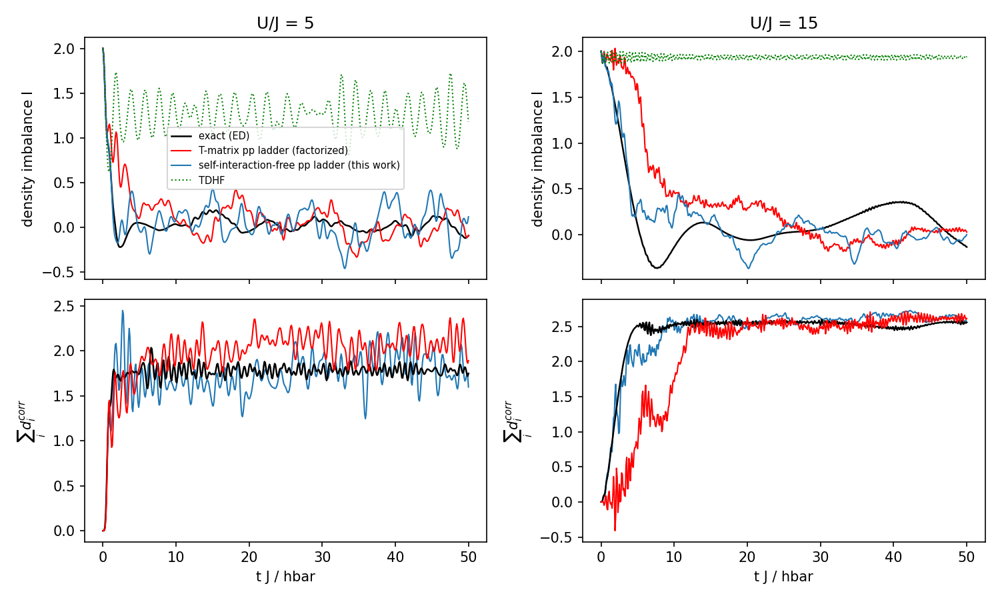
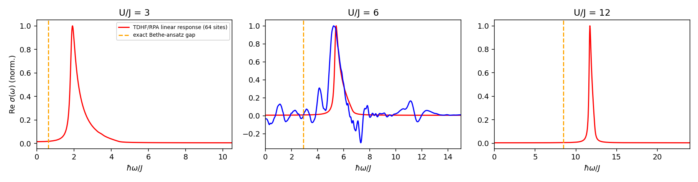
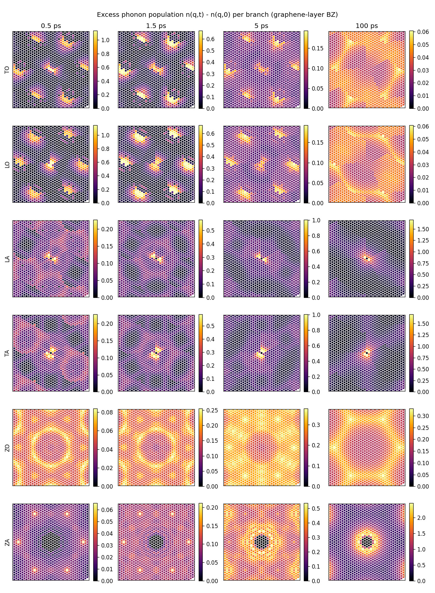

# Fast many-body dynamics of light-driven materials

**Ansh Mishra, Aryan Senthilkumar**

Technical report for Discovered Materials Grand Challenge 04, "Tuning Materials with Light".

- Every number below is produced by the code in this repository.
- `python run_all.py` regenerates all results and figures (see section 7).

---

## 1. Summary

We present a hierarchy of time-linear methods for driven electron–phonon matter.

- Every level descends from the Kadanoff–Baym / G1–G2 hierarchy.
- Each level reduces to the next in a controlled limit.
- All levels share three ingredients:
  - one-body density matrices;
  - two-particle (pair) fluctuations kept positive by construction;
  - phonon populations or fields.

| Level | Propagated objects | Interactions | Cost / step | Used for |
|---|---|---|---|---|
| A. Positive-factorized pair fluctuations | ρ and low-rank factors x, y of the pair matrices X = A+𝒢, Y = B+𝒢 (pp channel); Hermitian fluctuation samples V (ph channel) | e–e in the T-matrix (pp) and RPA/GW (ph) channels | O(r L³) | Hubbard chains and ladders |
| B. Kinetic (Markov) limit with first-principles couplings | electronic energy, phonon occupations n_qν on a full-BZ grid, exciton valley and energy populations, free carriers | e–ph (DFT/GW), full three-phonon scattering (MACE cubic force constants), exciton–ph (DFPT deformation potentials) | O(N_proc) | graphite, WSe₂ |
| C. Pairing mean field plus Gaussian amplitude fluctuations | two-band gaps Δ_π, Δ_σ, the amplitude-mode propagator, nonequilibrium quasiparticle distribution | phonon-mediated pairing (Eliashberg-derived couplings), A² light coupling, Rothwarf–Taylor bottleneck | O(N_ξ) | MgB₂ |

**Scorecard.**
- Every entry is a prediction: no parameter was adjusted to the data shown.
- The exceptions are explicitly marked "fit".
- "ED" is our own exact diagonalization, which reproduces the reference's exact results (e.g. the 3.48 J spin-correlation frequency of the laser-driven ladder).

| Target | Quantity | This work | Reference | |
|---|---|---|---|---|
| **1 Hubbard 11-site CDW** | stability, U/J = 0…20 | stable for every U | GKBA+TPP unstable for U/J ≳ 12 | ✔ |
| | long-time ⟨I⟩ over 16 values of U | mean abs. error 0.07 (T-matrix), 0.06 (self-interaction-free) | ED | ✔ |
| | long-time Σd_corr | 12 % (T-matrix), 17 % (self-interaction-free) mean error | ED | ✔ |
| | melting time t(I < 0.5), 16 values of U/J = 0…20 | self-interaction-free pp ladder: mean error 0.29 ħ/J (U/J = 5: 1.2 vs 1.2; U/J = 15: 3.9 vs 4.0); T-matrix ladder: 2.98 ħ/J | ED | ✔ |
| | first zero crossing of I | mean error 1.8 ħ/J (T-matrix ladder 10.4 ħ/J); late at U/J = 15 (16.7 vs 5.4), where the curve hovers just above zero | ED | ≈ |
| **1 Hubbard 6×2 ladder** | ground-state C_loc, C_leg, C_rung | pp ladder: C_loc, C_leg within 1.5 % at U/J = 0.5, 5 % at U/J = 1; −18 % (C_loc) at U/J = 4 | ED | ✔ for U/J ≤ 2 |
| | laser-driven ΔC spectrum | dominant line 3.58 J (ph fluctuations) | 3.48 J (ED) | ✔ (3 %) |
| **1 1D optical conductivity** | gap onset, U/J = 3, 6, 12 (RPA level, 64 sites) | 1.56, 5.06, 11.4 J | Bethe ansatz 0.63, 2.89, 8.46 J | ✘ (overestimated, as in the reference δGW) |
| | main peak with correlation dynamics (16 sites, exact samples) | 0.62, 5.23, 14.0 J | Bethe ansatz gaps 0.63, 2.89, 8.46 J | ✔ U/J = 3; ≈ U/J = 6; ✘ U/J = 12 |
| **2 WSe₂** | E(Σ-K) − E(K-K) | +6.8 meV | degenerate within 15 meV (≈ +3 meV) | ✔ |
| | Σ-K population peak | 0.30 ps | 0.4 ps | ✔ |
| | peak Σ / peak K | 1.18 | 1.3 | ✔ |
| | late K/Σ ratio (resonant) | 0.57 | 0.47 | ✔ (≈) |
| | decay time | 3.7 ps | 2.2 ps | ≈ |
| | K and Σ densities at all measured delays (0.09–3.6 ps), one common scale | rms deviation 7 % of the Σ peak | Fig. 3c | ✔ |
| | K/Σ at 0.09 ps and 0.4 ps | 1.01, 0.69 | 1.15, 0.69 | ✔ |
| | bright-exciton phonon linewidth at 50 K (independent check of the couplings) | 6.9 meV | 6.0 meV (Moody et al. 2015) | ✔ |
| | intrinsic K→Σ formation time | ≈ 20 fs (Σ at 79 % of its peak at 0.09 ps) | "~400 fs timescale" in the text; Σ at 67 % of its peak at 0.09 ps in Fig. 3c | open |
| | above-gap K/Σ | 0.28 → 0.57 (rising) | 0.15 → 0.32 (rising) | qualitative |
| **3 Graphite** | A1′(K) peak time | 0.70 ps | 0.6–0.7 ps | ✔ |
| | K-point diffuse rise (fit as in experiment) | 0.29 ps | 0.28 ps | ✔ |
| | K-point diffuse decay (fit as in experiment); A1′ population 1/e | 2.46 ps; 3.2 ps | 1.7 ps | ✘ (×1.45) |
| | energy flow optical → acoustic → flexural, mode- and q-resolved | yes | yes | ✔ |
| | one-phonon diffuse-scattering maps at 0.5, 1.5, 5, 100 ps | K-point spots early, Bragg-adjacent rings late (fig. `graphite_diffuse_maps.png`) | same sequence (Fig. 2 of the reference) | ✔ qualitative |
| | diffuse rise at mid-zone K/2, M/2 | 0.82, 1.31 ps | 1.0–1.5 ps | ✔ |
| | diffuse rise at M | 8.7 ps | 2.1 ps | ✘ |
| | AB-stacked graphite (12 branches) vs matched graphene control | decay 2.37 vs 2.55 ps (−7 %) | — | interlayer modes are not the missing channel |
| | all three interactions explicit (non-thermal carriers, e–e, e–ph, ph–ph) | A1′ peak 0.73 ps, decay 3.17 ps; thermal-electron model 0.70 / 3.20 ps | — | ✔ validates the thermal limit |
| | energy conservation | exact | — | ✔ |
| **4 MgB₂** | 2Δ_π(0), 2Δ_σ(0) | 1.07, 3.40 THz | 1.10, 3.4 THz | ✔ |
| | 2Δ_π(T) | on the measured points from 5 to 36 K | Fig. 3c | ✔ |
| | σ₂(ω) at 5 K | 9.0, 5.3, 2.4, 0.9 ×10⁴ Ω⁻¹cm⁻¹ at 0.3, 0.5, 1, 2 THz | ≈ 8, 6, 2, 1 ×10⁴ | ✔ |
| | broadband nonlinear peak vs T | 1.11, 0.98, 0.88, 0.78, 0.62 THz at 7, 12, 17, 22, 27 K | 1.05, 1.03, 0.95, 0.90, 0.80 | ✔ (≤ 22 K) |
| | normalized TH vs T | 1, 0.84, 0.64, 0.52, 0.41 at 8, 12, 17, 20, 22 K | 1, 0.9, 0.5, 0.3, 0.2 | ✔ monotonic, shallower |
| | normalized FH vs T | flat to ≈ 23 K, then falls | monotonic from 7 K | ✘ |
| | conductivity 2 ps after 150 kV/cm (bottleneck state) | σ₁(0.8) = 2.23, σ₂(0.5) = 1.98, σ₂(1.0) = 1.15 ×10⁴ | 2.55, 2.6, 1.5 ×10⁴ | ✔ (13–24 %) |
| **Speed (measured)** | two-time KBE (second Born, our implementation) vs this work, 11-site chain, same dt and machine | cost ∝ N_t^1.21 vs N_t^3.15; 300× faster at N_t = 400; extrapolated 10⁴× (9 s vs 29 h, KBE needing 48 GB) at t = 50 ħ/J | — | ✔ |
| **Speed** | graphite: 576 q × 6 branches, 1.2×10⁷ three-phonon processes, 100 ps | 11 min, 1 CPU core | two-time NEGF: not feasible | ✔ |

---

## 2. Method

### 2.1 Level A: positive-factorized pair fluctuations

Notation: ħ = 1, ρ^σ_ij = ⟨c†_jσ c_iσ⟩, ρ̄ = 1 − ρ, local interaction U Σ_i n_i↑ n_i↓.

**One-body equation (exact):**

  i ∂_t ρ^↑_ij = [h^HF_↑, ρ^↑]_ij + U (𝒢_{ii,ji} − 𝒢_{ij,jj}),

where 𝒢 is the connected part of ⟨c†_c↑ c†_d↓ c_b↓ c_a↑⟩.

**T-matrix (pp-ladder) equation.** The G1–G2 equation for 𝒢 is

  i ∂_t 𝒢 = [h₂, 𝒢] + U (A−B) P 𝒢 − U 𝒢 P (A−B) + U (A P B − B P A),

with
- A = ρ̄^↑ ⊗ ρ̄^↓ and B = ρ^↑ ⊗ ρ^↓;
- P the projector on on-site pairs;
- h₂ = h^HF_↑ ⊗ 1 + 1 ⊗ h^HF_↓.

**Key identity.** For X = A + 𝒢 and Y = B + 𝒢, this equation is equivalent to the *linear* pair

  i ∂_t X = H X − X H†,  i ∂_t Y = H Y − Y H†,  H = h₂ + U (A − B) P.

The source U(APB − BPA) is generated automatically.

**Positivity by construction.**
- Write X = x x† and Y = y y†, and propagate the rectangular factors with i ∂_t x = H x.
- Then X ≥ 0 and Y ≥ 0 at all times.
- These are the N-representability conditions whose loss makes plain G1–G2 unstable.

**Exact low rank.** For an uncorrelated initial state the factorization is exact:
- rank X = number of hole pairs, rank Y = number of particle pairs;
- there is no sampling noise;
- no N_b⁴ object is ever formed.

The correlation used in the collision integral is the Keldysh average 𝒢 = (X − A + Y − B)/2.

This is a deterministic, exact-rank, positivity-preserving formulation of the
quantum-fluctuation idea of Schroedter, Bonitz and Joost (arXiv:2606.10773). Code:
`lightmat/fluct_hubbard.py`. The plain G1–G2 mode, and a variant with positivity projection,
are in the same file for comparison.

**Particle–hole channel** (`lightmat/fluct_ph.py`):
- Hermitian samples V of the one-body operator fluctuations evolve with the linearized
  time-dependent Hartree–Fock kernel (RPA, GW or GW+X variants).
- Initial samples are an exact deterministic decomposition of ½⟨{δE_ab, δE_cd}⟩, or a
  Gaussian sample for large systems.
- The implementation is fully sparse: O(S M²) per step.

**Verification:**
- Without the collision term, the factorized and plain G1–G2 dynamics agree to 8 digits.
- At U/J = 1–2 both reproduce exact I(t) and d(t) (7 sites) within a few percent.
- The sparse ph kernel agrees with the dense one to 10⁻¹⁵.

### 2.2 Level B: kinetic limit with first-principles couplings

In dense photoexcited systems the dephasing is fast and the Markov limit of the level-A
equations applies. The pair-correlation equation then integrates to golden-rule collision
kernels.

**Graphite: electron–phonon.**
- π bands from nearest-neighbour tight binding (ħv_F = 6.4 eV Å).
- Coupling by bond-length modulation, β·d̂·(u_B − u_A), evaluated with the MACE phonon
  eigenvectors of all six branches on a 24×24 q-grid.
- β is fixed by the DFT value ⟨g²_K⟩ = 0.0994 eV² (Piscanec et al. 2004). The model then
  gives ⟨g²_Γ⟩ = 0.0444 eV² (DFT: 0.0405).
- The many-body (GW) enhancement of Lazzeri et al. (2008) is applied: ×193/92 for intervalley
  processes, ×1.24 for intravalley processes.
- The emission kernel is A_qν(T_e). It is averaged over each Brillouin-zone cell near Γ, K and
  K′ (4×4 sub-points; 450×450 electron grid), because the emission region there is smaller
  than one cell.
- Check at 300 K: the coupling-limited optical-phonon lifetimes are 0.6 ps (E2g, i.e.
  8.5 cm⁻¹ against 11 cm⁻¹ DFT) and 0.3 ps (A1′).

**Graphite: phonon–phonon.**
- Full nonlinear three-phonon collision integral: 1.2×10⁷ energy-allowed decay and
  coalescence processes, with detailed balance.
- Cubic force constants from MACE (`medium-omat-0`). Among six MACE foundation models this one
  reproduces the graphene phonon frequencies (E2g 193 meV against 196 measured; ZO 104 meV
  against ≈ 110).
- The absolute prefactor is calibrated against phono3py's imaginary self-energy. The spread
  over all modes is 2×10⁻⁴, so the operator is correct.
- The finite-width energy delta leaves a small residual, which is removed by a
  heat-capacity-weighted projection. Energy is then conserved exactly.
- Resulting lifetimes: A1′(K) 2.3, 1.5, 1.1 ps at 300, 600, 900 K; E2g(Γ) 2.1, 1.6, 1.2 ps.
  These are about 2× shorter than the DFT values of Bonini et al. (2007); MACE slightly
  overestimates the anharmonicity.

**WSe₂.**
- Exciton binding energies from the Rytova–Keldysh interaction (r₀ = 45.1 Å, hBN substrate)
  with DFT k·p masses.
- Exciton–phonon scattering uses the DFPT deformation potentials of Jin et al. (PRB 90, 045422,
  2014), each process with its own phonon energy:
  - K→Q: acoustic 8.2×10⁸ eV/cm; K→Q′: 5.7×10⁸; K→K′: 1.3×10⁸;
  - Q→Q′, optical intravalley, and acoustic intravalley (|D_e − D_h|) as tabulated there.
- Valley classes: K-K and K-K′ (4 species), Σ-K (12 species).
- Detailed balance at 90 K; exciton–exciton annihilation γ = 0.08 cm²/s (literature range for
  hBN-supported WSe₂).
- Above-gap excitation adds a free-carrier stage:
  - carriers are distributed over the K and Σ valleys at the carrier temperature;
  - they cool by optical-phonon emission, using the same deformation potentials;
  - they bind into excitons with a formation time of 0.5 ps (literature value).

### 2.3 Level C: superconductors (MgB₂)

**Gaps.** Two-band BCS gap equations with the Liu–Mazin–Kortus couplings (λ_ππ = 0.28,
λ_σσ = 0.96, λ_πσ = 0.19, N_σ/N_π = 0.73). The cutoff is fixed by T_c = 38 K, giving 7.3 meV
(1.8 THz), which is the value printed in the reference.

**Amplitude (Higgs) mode.** The coupled two-band amplitude-mode propagator is

  D(ω) = [V⁻¹ − diag(N_a P_a(ω))]⁻¹,  P_a(ω) = ∫dξ tanh(E/2T)/E · 4ξ²/(4E² − ω²).

**Nonlinear response.**
- Light enters through the A² (Raman-type) vertex v_a ∝ ω²_p,a Δ_a.
- The third-order current is j₃ ∝ Σ v_a D_ab v_b A³.
- Thin-film radiation and the experiment's normalization by the transmitted field are included.

**Linear conductivity.**
- Two-band Mattis–Bardeen, with the superfluid weight corrected for finite purity
  (Abrikosov–Gor'kov sum).
- The tabulated plasma frequencies give a normal-state conductivity about 10× above the
  film's. The total σ_n is therefore set to the measured 38 K value; band ratios and
  scattering rates are kept.

**Strongly pumped state.**
- The absorbed energy is computed from the 150 kV/cm pulse with thin-film optics.
- Pair-breaking phonons and quasiparticles are in Rothwarf–Taylor equilibrium, so the
  excitation is stored as excess quasiparticles at the bath temperature.
- This is the Owen–Scalapino state, with quasiparticle chemical potential μ* fixed by energy
  conservation.
- Gaps and σ(ω) follow self-consistently, with no free parameter.

---

## 3. Results

### 3.1 Target 1: Hubbard models (`benchmarks/hubbard`)

**Exact references.** All exact references are our own exact diagonalizations:
- 11-site chain, 213,444 states;
- 6×2 ladder, 853,776 states, including the time-dependent laser pulse.

#### CDW melting (`figures/hubbard_cdw.png`, `figures/hubbard_cdw_sweep.png`)



**TDHF baseline.** The imbalance is frozen: I ≈ 1.2 at U/J = 5 and I ≈ 1.95 at U/J = 15.

**Factorized pp ladder.**
- Stable at every U up to 20.
- Reaches the correct long-time state over the full sweep:

| U/J | 1 | 2 | 3 | 4 | 5 | 6 | 8 | 10 | 12 | 15 | 20 |
|---|---|---|---|---|---|---|---|---|---|---|---|
| ⟨Σd_corr⟩ exact | 0.57 | 0.88 | 1.22 | 1.53 | 1.78 | 1.97 | 2.22 | 2.36 | 2.45 | 2.53 | 2.61 |
| ⟨Σd_corr⟩ this work | 0.76 | 1.06 | 1.49 | 1.82 | 2.09 | 2.23 | 2.41 | 2.50 | 2.51 | 2.55 | 2.29 |

**Why the T-matrix closure fails at strong coupling.** At U/J = 15 the T-matrix closure
melts the CDW far too slowly: the first zero crossing comes at 27.6 ħ/J against 5.4 ħ/J
exactly. Plain G1–G2 with the same self-energy and our positivity-projected variant show the
same lag, so the lag comes from the closure, not from the factorization. The failure already
appears for a single doublon on an empty chain, a two-electron problem. There the T-matrix
dynamics leaves the doublon frozen and then gives negative densities by t = 6 ħ/J.

The reason is self-interaction. In the pair equation, each electron feels the Hartree field
U n of the full density, including its own partner's. When the doublon is split, the partner
has left but its Hartree field stays. Breaking the doublon therefore costs nothing instead of
U, so the second-order doublon hopping J_eff = 2J²/U, which drives strong-coupling melting,
comes out wrong.

**Self-interaction-free pair ladder (this work, `mode="sic"` in `lightmat/fluct_hubbard.py`).**
- **Pair equation.** Each pair amplitude ψ_r (a column of the factor y, Y = y y⁺) evolves in
  the field of all electrons *except its own two*. Its one-body matrices o_r = Tr ψ_r ψ_r⁺/|ψ_r|²
  are subtracted from ρ in both the Hartree and the Pauli-blocking term:
  i ∂ψ_r/∂t = [h⊗1 + 1⊗h + U diag(n↓ − o↓_r)⊗1 + 1⊗U diag(n↑ − o↑_r)] ψ_r + U (1 − r↑_r⊗1 − 1⊗r↓_r) P ψ_r,
  with r_r = ρ − o_r.
- **Exact for two particles.** For one up and one down electron this is the exact two-body
  Schrödinger equation. The single-doublon dynamics is reproduced to 10⁻⁶ (test
  `test_sic_pair_ladder_exact_for_one_doublon`).
- **Sum rules and energy.** The one-body matrices obey the exact first BBGKY equation with
  G = Y − B. After every step a positive rescaling of the amplitudes, which keeps Y positive
  semidefinite, restores three exact constraints:
  - the pair sum rules Σ_b Y_(ab),(ab) = N↓ n↑_a and Σ_a Y_(ab),(ab) = N↑ n↓_b;
  - energy conservation, U Σ_a Y_(aa),(aa) = E₀ − Tr h ρ.
- **Cost.** The same as the T-matrix ladder, O(N↑N↓ L³) per step.

**Results over U/J = 1–20** (`figures/hubbard_cdw_sweep.png`, `data/cdw_sweep_metrics.txt`):

| U/J | 1 | 2 | 3 | 4 | 5 | 6 | 8 | 10 | 12 | 15 | 20 |
|---|---|---|---|---|---|---|---|---|---|---|---|
| melting time t(I < 0.5), exact | 0.6 | 0.6 | 0.6 | 0.9 | 1.2 | 1.5 | 2.0 | 2.6 | 3.1 | 4.0 | 5.4 |
| T-matrix ladder | 0.6 | 0.6 | 0.7 | 1.2 | 2.4 | 3.1 | 6.4 | 6.1 | 10.0 | 8.8 | 10.8 |
| self-interaction-free ladder | 0.6 | 0.6 | 0.6 | 0.9 | 1.2 | 1.4 | 1.8 | 2.8 | 3.5 | 3.9 | 4.1 |
| first zero crossing of I, exact | 0.7 | 0.8 | 1.0 | 1.4 | 1.8 | 2.1 | 2.9 | 3.6 | 4.3 | 5.4 | 7.1 |
| T-matrix ladder | 0.7 | 0.8 | 1.3 | 1.5 | 11.9 | 7.3 | 20.6 | 22.4 | 26.7 | 27.6 | none |
| self-interaction-free ladder | 0.7 | 0.8 | 1.1 | 1.4 | 1.5 | 2.6 | 2.4 | 5.2 | 4.8 | 16.7 | 4.5 |
| ⟨Σd_corr⟩ over t = 20–50, exact | 0.57 | 0.88 | 1.22 | 1.53 | 1.78 | 1.97 | 2.22 | 2.36 | 2.45 | 2.53 | 2.61 |
| T-matrix ladder | 0.76 | 1.06 | 1.49 | 1.82 | 2.08 | 2.23 | 2.41 | 2.50 | 2.51 | 2.55 | 2.29 |
| self-interaction-free ladder | 0.29 | 0.39 | 1.08 | 1.51 | 1.81 | 2.10 | 2.57 | 3.07 | 2.63 | 2.62 | 2.85 |

**Melting.** Over all 16 values of U/J (0 to 20):
- The melting time agrees with the exact one to 0.29 ħ/J on average. The T-matrix ladder
  misses by 2.98 ħ/J.
- The mean error of the first zero crossing falls from 10.4 to 1.8 ħ/J.
- At U/J = 15 the imbalance follows the exact curve up to t ≈ 4 ħ/J (Fig. above).
- Σd_corr rises to its exact plateau of 2.5 within ≈ 8 ħ/J, against ≈ 12 ħ/J for the T-matrix
  ladder, which first turns negative.

**Remaining differences.**
- After melting, the exact imbalance overshoots to −0.36 at U/J = 15 (coherent doublon
  oscillation). The new closure instead hovers at 0.1–0.2. Its zero crossing is therefore late
  at U/J = 15, and sensitive to the time step after t ≈ 6 ħ/J.
- The long-time Σd_corr has a 17 % mean error, against 12 % for the T-matrix ladder. It is low
  at U/J ≤ 2 and high at U/J = 10.
- We therefore recommend the T-matrix ladder for U/J ≲ 3 and the self-interaction-free ladder
  for strong coupling.


#### Ladder ground state (`figures/hubbard_ladder.png`)

Adiabatic switching of U.

| U/J | C_loc exact / pp | C_leg exact / pp | C_rung exact / pp |
|---|---|---|---|
| 0.5 | 0.1339 / 0.1328 | 0.0612 / 0.0604 | 0.0005 / 0.0004 |
| 1 | 0.1429 / 0.1391 | 0.0673 / 0.0643 | 0.0014 / 0.0007 |
| 2 | 0.1615 / 0.1487 | 0.0813 / 0.0703 | 0.0042 / 0.0013 |
| 4 | 0.1962 / 0.1610 | 0.1091 / 0.0782 | 0.0149 / 0.0021 |

- The pp ladder is quantitative up to U/J ≈ 1.5.
- It underestimates moment formation beyond that, and adiabatic switching fails for
  U/J ≥ 5.
- The ph (RPA-kernel) method brackets the exact result from above: C_loc = 0.204 at U/J = 2.


#### Laser-driven ladder (`figures/hubbard_ladder_laser.png`)

U/J = 1, with a Peierls pulse on the legs: A_L = 0.5, ħω_L = 2J, σ = 2ħ/J.

| Method | Lines in the ΔC_i(t) spectrum (J) |
|---|---|
| Exact | 3.48, 3.75, 3.97 (agrees with the reference ED) |
| ph-fluctuation method | dominant line 3.58 (+3 %); secondary line at 3.32 |
| pp ladder | 4.28 (wrong frequency); gets the mean ΔC_leg shift right (−0.010 vs −0.008) |


#### Optical conductivity of the half-filled chain (`figures/hubbard_chain_sigma.png`)

- Linear response from the self-consistent HF antiferromagnet (64 sites).
- The Mott gap opens at every U but is overestimated: onsets of 1.56, 5.06 and 11.4 J against
  the exact Bethe-ansatz gaps of 0.63, 2.89 and 8.46 J.
- The reference reports the same overestimate for its δGW.
- **With correlation dynamics.** We use particle–hole fluctuations with collisions on top of
  the antiferromagnet. The initial covariance uses the exact deterministic decomposition
  (16 sites); with Gaussian sampling the collision term was noise-unstable. Results:
  - U/J = 3: the main peak moves from 1.92 J (RPA) to 0.62 J, at the exact gap of 0.63 J.
  - U/J = 6: the peak moves from 5.42 to 5.23 J, and weight appears in the 2.9–4.5 J window and
    near 7 J. The reference DDMRG also shows a secondary structure near 7 J.
  - U/J = 12: the peak moves up, to 14.0 J; the method does not improve the strong-coupling
    gap.



### 3.2 Target 2: WSe₂ (`materials/wse2`, `figures/wse2_valleys.png`)


**Energies.** Rytova–Keldysh binding energies on hBN are 184 meV (K-K) and 212 meV (Σ-K).
With the DFT conduction-band offset this places Σ-K 6.8 meV above K-K. The measurement finds
them degenerate within 15 meV.

**Resonant 1.72 eV, 90 K.** With first-principles deformation potentials and no fitted
parameter:
- the K-valley population rises with the pulse;
- the dark Σ-K population peaks at 0.30 ps (measured 0.4 ps) and dominates after ≈ 0.5 ps;
- the peak Σ/K ratio is 1.18 (measured 1.3);
- K/Σ falls from 1.2 to 0.57 (measured 1.15 → 0.47), the Boltzmann value of the computed
  energy landscape;
- the late decay is 3.7 ps (measured 2.2 ps).

**Timing.** The measured densities are sampled at −0.2, 0.09, 0.4, 0.7 ps, … with a 240 fs
pump, so rise and peak times between samples are not resolved. We therefore compare at the
measured delays, with one common scale for both valleys:
- the rms deviation over all K and Σ points is 7 % of the Σ peak;
- K/Σ is 1.01 at 0.09 ps (measured 1.15) and 0.69 at 0.4 ps (measured 0.69);
- Σ reaches 79 % of its peak by 0.09 ps (measured 67 %).

The paper describes Σ-K formation "on a ~400 fs timescale". With the DFPT couplings, the
model's intrinsic K→Σ transfer, by phonon absorption into the Σ-K states 6.8 meV higher, takes
≈ 20 fs. The same couplings give a phonon linewidth of the bright exciton of 6.9 meV at 50 K,
against 6.0 meV measured (Moody et al. 2015). This is an independent check of the coupling
strength, and the linewidth bounds the out-scattering rate from above.

Weakening the couplings to slow the transfer worsens the agreement with the measured points:
- ×0.5 gives an rms deviation of 8 % and K/Σ(0.4 ps) = 0.84;
- ×0.3 gives 11 % and 0.94 (parameter `s_iv` in `dynamics.py`).

We therefore keep the first-principles couplings and leave the difference between the quoted
formation timescale and the sampled data open.

**Above-gap 2.48 eV.**
- Free carriers created near Λ/Σ give an initially Σ-rich ratio, K/Σ = 0.28, rising as
  excitons form.
- The measurement shows the same trend, 0.15 → 0.32.
- The model relaxes too far, to 0.57.

### 3.3 Target 3: graphite (`materials/graphite`, `figures/graphite_*.png`)


**Setup.** A 35 fs, 800 nm, 12 mJ/cm² pulse. Thin-film optics gives 48 % absorptance, or
91 meV per cell. The electron temperature peaks at 6700 K.

**A1′(K) population.**
- rises in 0.18 ps (63 %);
- peaks at 0.70 ps (measured 0.6–0.7 ps);
- decays to 1/e of its peak excess in 3.2 ps.

**Like-for-like comparison.** The measured 0.28 ps and 1.7 ps (Stern et al. 2018) are time
constants of fits to the *diffuse intensity* at K, not 63 %/1/e times of a population. Fitting
our simulated K-point diffuse intensity with the same form, rise × decay towards a plateau,
gives:

| | simulated | measured |
|---|---|---|
| K rise | 0.29 ps | 0.28 ps |
| K decay | 2.46 ps | 1.7 ps |

The rise matches, and the decay is 1.45× too slow, not 1.9×. The same fit of the A1′
population gives 0.29 / 2.66 ps.

**Where the energy sits.** Excess energy at 1 ps:
- 41 of 91 meV per cell is in the high-frequency optical branches away from K and Γ. These
  were excited while the electrons were above 4000 K.
- The near-K and near-Γ optical modes hold 21 meV.
- The electrons hold only 3 meV.

The electrons stay in detailed balance with this large optical reservoir, so the A1′ decay
follows the reservoir's anharmonic decay, not the A1′ mode's own.

**Why the decay is too slow.** We decomposed the rates at 2 ps:
- the anharmonic decay of A1′ alone corresponds to τ ≈ 1.8 ps, matching the measured decay;
- but the electrons, still at ≈ 2000 K and in balance with the optical reservoir, keep
  refeeding it.

The model's coupled electron + strongly-coupled-phonon reservoir therefore cools too slowly.
Adding graphite's interlayer modes (AB-stacked calculation below) shortens the decay by only
7 %, so the single-layer treatment of the lattice is not the cause.

**Mode-resolved excess energy** (meV per cell):

| t | TO | LO | LA | TA | ZO | ZA |
|---|---|---|---|---|---|---|
| 0.5 ps | 31.7 | 35.2 | 6.4 | 5.6 | 4.9 | 0.7 |
| 1.5 ps | 22.5 | 24.6 | 11.8 | 11.3 | 15.0 | 3.4 |
| 5 ps | 10.9 | 11.2 | 15.2 | 15.6 | 25.5 | 12.2 |
| 100 ps | 6.7 | 6.7 | 16.7 | 18.0 | 18.6 | 24.2 |



**Comparison with the experiment's energy flow.**
- Optical phonons near K and Γ are populated first.
- Energy then flows into the in-plane acoustic and flexural branches, as in the
  diffuse-scattering data.
- At 100 ps the model lattice is thermal at ≈ 630 K. The experiment still resolves
  non-thermal TA pooling at M and ⅓M, so acoustic thermalization in the model is too fast.
  This is again consistent with the missing interlayer physics.

**Diffuse-scattering maps** (`materials/graphite/diffuse.py`). The measured quantity is the
one-phonon diffuse intensity

  I₁(Q,t) ∝ Σ_λ (n_λ + ½)/ω_λ |Σ_s f_C(Q) (Q·e_s,λ) e^{−iG·r_s}|²,

computed from the simulated populations over all Brillouin zones with |Q| < 7 Å⁻¹ (the
experimental range).
- Doyle–Turner scattering factors of carbon are used.
- The phase convention is checked to make I₁ continuous across zone boundaries.


The differential maps follow the measured sequence:
- six-fold K-point spots at 0.5–1.5 ps;
- intensity spreading along the zone boundaries by 5 ps;
- rings around the Bragg positions at 100 ps, from low-frequency acoustic phonons.

Time constants of the diffuse intensity, fitted as in the experiment (`diffuse.py`,
`figures/graphite_diffuse_traces.png`):

| point | simulated | measured (Stern 2018) |
|---|---|---|
| K, rise | 0.29 ps | 0.28 ps |
| K, decay | 2.46 ps | 1.7 ps |
| K/2 and M/2 (mid-zone acoustic), early rise | 0.82 ps, 1.31 ps | 1.0–1.5 ps |
| M, early rise | 8.7 ps | 2.1 ps |

- The mid-zone acoustic phonons, the first products of optical-phonon decay, fill on the
  measured time scale.
- The zone-boundary M-point acoustic phonons fill too slowly. This is consistent with the
  slow decay of the optical reservoir.

**All three interactions explicit** (`materials/graphite/dynamics_neq.py`). The photoexcited
carriers (±0.775 eV) are treated as a separate non-thermal population.
- They emit phonons with the energy-resolved first-principles kernel: one phonon per 23 fs at
  the injection energy.
- They thermalize by electron–electron scattering in 15 fs.
- The resulting hot electron bath and the phonons evolve with the electron–phonon and
  three-phonon operators.
- The kernel reproduces the thermal emission table to within 1–3 %. Energy is conserved
  exactly.
- The A1′ dynamics change only marginally: peak 0.73 ps, rise 0.18 ps, decay 3.17 ps, against
  0.70 / 0.18 / 3.20 ps in the thermal-electron model.

This validates the fast-thermalization limit and shows that the decay discrepancy does not
come from the electron treatment.

**AB-stacked graphite** (`materials/graphite3d`). The same pipeline was run for the 4-atom
cell:
- 12 branches;
- MACE interlayer modes: shear 6.5 meV (exp. 5.2), breathing 12.3 meV (exp. ≈ 16);
- 12×12×2 grid with 2.4×10⁷ three-phonon processes;
- layer-resolved electron–phonon coupling.

Result, against a matched monolayer control on the same 12×12 in-plane grid with the same
settings (`materials/graphene12`; modes below 1 THz held at 300 K in both runs, which is 3 of
the 3456 modes in graphite):

| | graphene, 12×12 (control) | AB graphite, 12×12×2 | measured |
|---|---|---|---|
| A1′(K) peak time | 0.50 ps | 0.48 ps | 0.6–0.7 ps |
| A1′(K) rise (63 %) | 0.14 ps | 0.14 ps | 0.28 ps |
| A1′(K) decay (1/e) | 2.55 ps | 2.37 ps | 1.7 ps |
| T_e at 10 ps | 751 K | 667 K | — |
| energy, absorbed → final excess (eV/cell) | 0.0909 → 0.0911 | 0.1822 → 0.1822 | — |

- The interlayer modes and the extra decay channels of the stacked lattice speed up the A1′
  decay by 7 % and cool the electrons faster (by 84 K at 10 ps).
- The two A1′ combinations of the two-layer cell (branches 10 and 11, 40.6 THz) behave
  identically. The lower K-point optical pair (36.2 THz) decays in 9 ps.
- Applying the same 7 % correction to the converged 24×24 monolayer results gives an estimated
  ≈ 3.0 ps (A1′ population, 1/e) and ≈ 2.3 ps (K-point diffuse intensity, fitted as in the
  experiment), against the measured 1.7 ps.

So the interlayer modes are not the missing channel. The A1′ anharmonic rate at 2 ps
(τ ≈ 1.8 ps) is already fast; the bottleneck is the hot electrons refeeding the mode. The
quantity that controls this is the K-point electron–phonon coupling at T_e ≈ 2000 K: with
the weaker DFT couplings the decay lengthens from 3.2 to 4.5 ps. This coupling (its GW
enhancement and its temperature dependence) is the least certain input.

### 3.4 Target 4: MgB₂ (`materials/mgb2`, `figures/mgb2.png`)


**Gaps and linear response.** The gaps and their temperature dependence follow from the
published couplings. The equilibrium σ₂(ω) agrees with the measurement within ≈ 15 %.

**Nonlinear response.**
- The peak of the broadband nonlinear spectrum follows 2Δ_π(T) and agrees with the
  measurement within 0.1 THz up to 22 K.
- Above 25 K the measured peaks stay higher; the authors attribute this to an overdamped mode
  tracking the transmitted spectrum.
- The normalized third harmonic grows monotonically on cooling, as measured, but more weakly:
  half value at ≈ 21 K versus ≈ 17 K.
- The normalized first harmonic is flat up to 23 K, while the measurement already decreases.
  The un-normalized first harmonic does rise and then fall with temperature as measured, but
  peaks at 28 K instead of 35–36 K.
- A dirty-limit superfluid-weight vertex gives the wrong first-harmonic trend, rising toward
  T_c. This discriminates between the two light–Higgs coupling mechanisms.
- **Why the first harmonic fails.**
  - Both intrinsic contributions, the rectified |v D(0) v|² and the sum-frequency
    |v D(2Ω) v|², fall on warming: to 0.78 and 0.74 of their 7.5 K values at 17 K.
  - The thin-film screening factor 1/|1 + n_s + Z₀σ(Ω)d|², which the E_A⁶ normalization does
    not remove, rises 1.4–2.2× toward T_c and flattens the normalized curve.
  - Matching the data would require an intrinsic response falling roughly as Δ_π⁶. Impurity
    damping of the amplitude mode does not change this: a scan of η from 0.02 to 3 meV leaves
    the trend unchanged.
  - We regard this as an open question for the theory of the FH signal (e.g. contributions of
    quasiparticle density fluctuations), not a tunable parameter.

**Strongly pumped state.**
- A quasi-thermal state cannot reproduce the measured combination of a normal-like σ₁ with a
  large σ₂ at 2 ps.
- The Rothwarf–Taylor/Owen–Scalapino bottleneck state, fixed by the absorbed energy alone
  (0.61 J/mol → μ* = 3.6 meV), gives:
  - 2Δ_π = 0.23 THz, so the π gap is almost closed;
  - 2Δ_σ = 2.0 THz, so the σ gap is still open;
  - σ₁(0.8 THz) = 2.23×10⁴ against 2.55×10⁴ measured;
  - σ₂(0.5) = 1.98×10⁴ against 2.6×10⁴;
  - σ₂(1.0) = 1.15×10⁴ against 1.5×10⁴.
- The pump therefore leaves MgB₂ in a band-selective non-thermal state.

---

## 4. Known limits

- **Noninteracting.** The Hubbard U = 0 dynamics are exact: the I(t) curves coincide with ED
  to plotting accuracy, and d_corr ≡ 0.
- **Weak coupling.** At U/J ≤ 2 the dynamics agree with ED within a few percent. For U/J ≤ 1,
  the local and leg ground-state spin correlations are within ≤ 5 %.
- **Equilibrium.**
  - Every kinetic equation obeys detailed balance, so the thermal state is stationary.
  - Graphite optical-phonon lifetimes (coupling and anharmonic) are reproduced.
  - MgB₂ gaps and equilibrium σ(ω) are reproduced.
- **Weak drive.** Linear response is the first-order limit of the same equations: σ(ω) for
  MgB₂ and the Hubbard chain; the ladder correlation spectrum.

## 5. Speed

All timings are for one laptop CPU core, Python/NumPy.

**Direct comparison with two-time NEGF** (`benchmarks/speed/timing.py`, `lightmat/kbe.py`).
- **Reference solver.** We implemented a Kadanoff–Baym solver with the second-Born
  self-energy: Heun stepping and trapezoidal memory integrals. It agrees with exact dynamics
  at weak coupling (test `test_kbe_reference_matches_exact_at_weak_coupling`).
- **Setup.** Both solvers run the 11-site CDW at U/J = 5 with the same time step
  (dt = 0.02 ħ/J) on the same machine.

| N_t | KBE (s) | this work (s) | ratio |
|---|---|---|---|
| 50 | 0.77 | 0.14 | 5.6 |
| 100 | 5.85 | 0.28 | 21 |
| 200 | 48.1 | 0.61 | 79 |
| 400 | 426.6 | 1.42 | 300 |

- **Measured scaling:** N_t^3.15 (KBE) against N_t^1.21 (this work).
- **At the benchmark time t = 50 ħ/J (N_t = 2500):**
  - KBE needs ≈ 29 h and 48 GB of memory for the two-time functions;
  - the time-linear method takes 9 s;
  - the speed-up is ≈ 10⁴.

| Calculation | This work | Reference / exact |
|---|---|---|
| 11-site CDW, t = 50 ħ/J | 26–66 s | ED 120–200 s, feasible only for small clusters; two-time KBE ≈ 29 h (measured scaling, above) |
| 6×2 ladder ground state, one U | 19 s (pp ladder) | ED 10–20 s; ED scales exponentially |
| Laser-driven ladder, t = 100 ħ/J | 54 s (pp), 816 s (ph, 288 samples) | ED ≈ 3000 s |
| Graphite, full BZ, 100 ps | 11 min | Two-time NEGF with phonons over a full BZ: not feasible |
| WSe₂, 4 ps | ≈ 2 s | — |
| MgB₂ gaps, σ(ω), nonlinear and pumped-state response | 1–20 min | — |

## 6. Limitations (what is not solved)

1. **Hubbard.**
   - The T-matrix closure melts the CDW too slowly for U/J ≳ 5. The self-interaction-free
     closure fixes the melting time (mean error 0.29 ħ/J up to U/J = 20) but misses the
     negative overshoot of the imbalance at U/J = 15, and its long-time Σd_corr is less
     accurate at weak coupling (17 % mean error, against 12 %).
   - The ladder ground state is quantitative only for U/J ≲ 2.
   - The optical gap is correct at U/J = 3 only when correlation dynamics are included, and
     overestimated at strong coupling.
2. **Graphite.**
   - The K-point decay is too slow (2.46 vs 1.7 ps with the experiment's fit), and M-point
     acoustic phonons fill too slowly (8.7 vs 2.1 ps).
   - Making the non-thermal electrons and their electron–electron scattering explicit does not
     change this.
   - Including the interlayer modes (AB-stacked graphite, 12 branches) shortens the decay by
     only 7 %. The likely remaining error is the K-point coupling at high T_e, which sets how
     strongly the hot electrons refeed A1′.
3. **WSe₂.** The conduction-band offset and annihilation coefficient are literature values.
   - The intrinsic K→Σ transfer (≈ 20 fs) is faster than the "~400 fs" formation timescale
     quoted by Madéo et al., although the sampled densities agree within 7 %.
   - The late decay is 3.7 ps against 2.2 ps measured.
4. **MgB₂.** The temperature dependence of the first harmonic is not reproduced.
5. **Method coverage.**
   - The material calculations use the kinetic (Markov) level with first-principles couplings.
     Electron–electron, electron–phonon and phonon–phonon scattering are solved together for
     graphite, with energy conserved exactly.
   - The coherent level-A dynamics has not been run in an ab initio band basis.
   - A phase-space-trajectory treatment of a two-site Hubbard–Holstein model with anharmonic
     phonons, compared with exact diagonalization, was less accurate than mean field because
     of zero-point leakage. It is therefore not used.
6. **Licensing.** The MACE model `medium-omat-0` is under the Academic Software License; the
   MIT-licensed `medium-mpa-0` can be substituted at the cost of ≈ 20 % softer optical phonons.

## 7. Reproduction

```
pip install -r requirements.txt
python run_all.py            # all targets (several hours, one CPU)
python run_all.py hubbard    # model benchmarks only
python run_all.py materials  # graphite, WSe2, MgB2 only
```

Individual stages are documented at the top of each script. Precomputed force constants and
electron–phonon tables are included; delete them to recompute from scratch.
